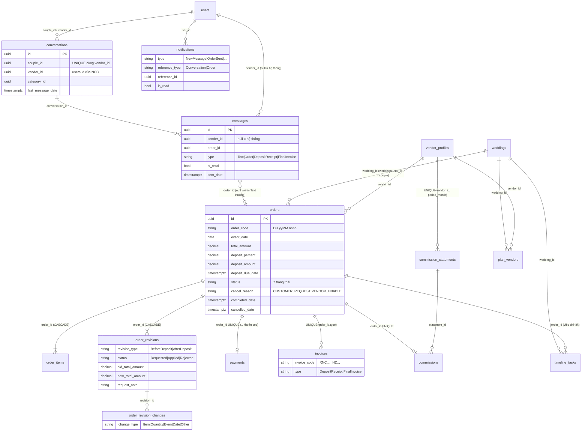
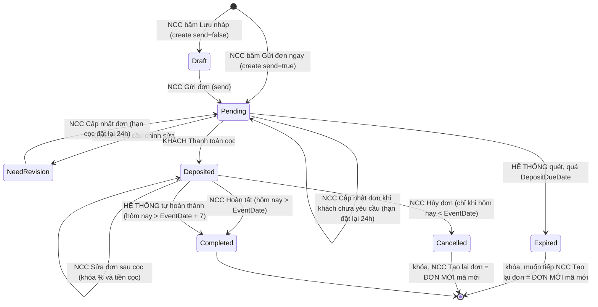
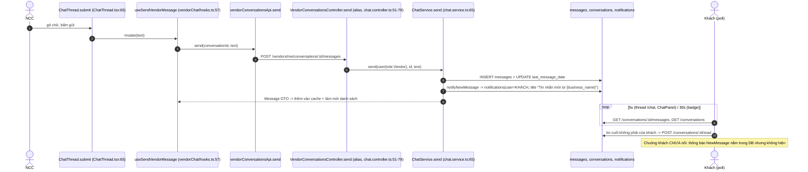

# Luồng chat và đơn hàng: từ tin nhắn đầu tiên đến hoàn thành

> Dành cho lập trình viên **chưa biết dự án**. Đọc xong phải nắm trọn luồng NCC và khách nhắn qua lại, NCC gửi đơn, khách đặt cọc hoặc yêu cầu chỉnh sửa, hoàn thành; biết mọi trường hợp của đơn; và tự sửa được code.
> Viết ngày 28/10/2026 từ **code thật** (nhánh `Chanh`) và các tài liệu trong `docs/`. Chỗ code lệch quy tắc nghiệp vụ đã chốt được đánh dấu **⚠️ LỆCH**. Không chắc thì ghi **chưa xác minh**.
> Đường dẫn trong file này bấm được trong VS Code (dạng `file:dòng`). Số dòng đúng tại thời điểm viết; code đổi thì lệch vài dòng.

> ### ⚠️ Cập nhật sau khi gộp `main` vào `Chanh` (28/10/2026)
> Nội dung bên dưới viết trước khi gộp. Các chỗ sau **đã đổi**, đọc kèm bảng này:
>
> | Chủ đề | Trước | Sau khi gộp |
> |---|---|---|
> | Dữ liệu giả | Có `VITE_USE_MOCK`, `VITE_REAL_APIS`, "Giả lập khách/thời gian" | **Đã gỡ hoàn toàn** (mục D9) |
> | Thanh toán cọc | Chỉ `simulate`; VNPay thật là ⚠️ G18 | **VNPay thật đã có** ([integrations/vnpay/vnpay.ts](../backend/src/integrations/vnpay/vnpay.ts)): `createDeposit` trả URL, `POST /payments/vnpay/confirm`, IPN `GET /payments/vnpay/ipn` ([payments-gateway](../backend/src/modules/payments-gateway/payments-gateway.controller.ts)); `simulate` vẫn là mặc định khi chưa cấu hình |
> | Thông báo | `/notifications` dùng chung mọi vai trò, chuông NCC [NotificationMenu] | `/notifications` **chỉ cho khách**; NCC dùng `/vendors/me/notifications`, admin `/admin/notifications`. Chuông khách đã nối ([CoupleNotificationBell](../frontend/src/features/coupleNotifications/components/CoupleNotificationBell.tsx)) nên **G4 đã được xử lý**; chuông NCC là [VendorNotificationBell](../frontend/src/features/vendorNotifications/components/VendorNotificationBell.tsx). Toast tin nhắn NCC ([MessageToaster](../frontend/src/features/notifications/components/MessageToaster.tsx)) vẫn giữ |
> | Hoa hồng | API `lines`/`pay` kiểu cũ, nộp ngay ở chế độ thử | API của `main`: `GET /vendors/me/commissions` (+ `/:id`), nộp qua VNPay; hạn nộp: backend dùng **ngày 25** tháng sau ([commissions.service.ts](../backend/src/modules/commissions/commissions.service.ts), [order-lifecycle.ts](../backend/src/modules/orders/order-lifecycle.ts)) nhưng hằng số FE `COMMISSION_DUE_DAY` ([constants.ts](../frontend/src/features/commissions/constants.ts)) và chú thích kiểu ghi **ngày 20**: **lệch, hỏi nhóm**; bảng kê đã thanh toán thì hoa hồng đơn hoàn thành sau đó **dồn sang tháng sau** ([order-lifecycle.ts](../backend/src/modules/orders/order-lifecycle.ts) `addCommission`) |
> | Tự hoàn thành đơn | Job của `Chanh` ([order-jobs.service.ts](../backend/src/modules/orders/order-jobs.service.ts), mặc định tắt) | Giữ job của `Chanh`. Job của `main` (`OrderAutoCompleteService`, chạy mỗi giờ, **nhắc NCC trước 2 ngày**) **không được đưa vào**: nhắc trước 2 ngày hiện **chưa có** |
> | Schema | Cột bắt buộc | `schema.prisma` của `main` (đã `db pull` lại): hầu hết cột thành nullable; thêm `snapshot`, `min_tables`; code `Chanh` dùng `!` / `?? ''` cho các cột này |
> | Giá theo mâm (Trung tâm tổ chức sự kiện) | không có | Có: `priceUnit`, `minTables`, [catalog/price.ts](../frontend/src/features/catalog/price.ts) |
> | Số dòng trong file này | đúng lúc viết | **Lệch** ở orders.service.ts (thêm ~120 dòng VNPay), chat.service.ts, order-lifecycle.ts |

---

## QUY TẮC CHO NGƯỜI SỬA

1. **Database Supabase dùng chung cả nhóm.** Không có DB riêng để thử.
2. **KHÔNG chạy** `prisma db pull`, `prisma migrate dev/reset/deploy`, `prisma db push`, `prisma db execute`. (`db pull` ghi đè `schema.prisma`; các lệnh còn lại có thể xóa hoặc đổi dữ liệu thật.)
3. **KHÔNG** `ALTER`, `DROP`, `UPDATE`, `DELETE` lên dữ liệu cũ. Chỉ `SELECT` khi cần xác nhận.
4. Muốn đổi cấu trúc DB: **viết file SQL đề xuất** (xem mẫu [backend/prisma/sql/2026-10-27-orders-cancel-reason.sql](../backend/prisma/sql/2026-10-27-orders-cancel-reason.sql)) rồi **hỏi nhóm**; người quản DB là người chạy. Sau khi DB đổi mới sửa `schema.prisma` bằng tay và `npx prisma generate`.
5. **Không commit `.env`** (`backend/.env`, `frontend/.env`). Chỉ commit `.env.example`.
6. Làm trên **nhánh riêng**, xong tạo **PR vào nhánh `Chanh`**. Không push thẳng.
7. Trước khi commit chạy: `cd backend && npx tsc --noEmit -p tsconfig.json` và `cd frontend && npm run build`. Cả hai phải sạch lỗi.
8. Cách chạy dự án, tài khoản mẫu và mật khẩu: xem [HUONG_DAN_CHAY.md](../HUONG_DAN_CHAY.md). **Không chép mật khẩu vào tài liệu.**
9. Đọc trước khi sửa phần NCC: [CHOT_NGHIEP_VU_NCC.md](CHOT_NGHIEP_VU_NCC.md). Khi mâu thuẫn, ưu tiên: `database.md` > `CHOT_NGHIEP_VU_NCC.md` và `api/THE_DON_HANG.md` > các `api/*.md` cũ.

## CẬP NHẬT 28/10/2026 (nhánh `feat/order-flow-realtime`)

Các phần dưới viết trước đợt này; chỗ nào mâu thuẫn thì **mục này đúng**.

| Thay đổi | Chi tiết | File chính |
|---|---|---|
| **Realtime (Socket.IO)** | Tin nhắn, thẻ đơn, đơn đổi trạng thái, đã đọc, thông báo đẩy tới hai bên ngay (thay polling 5 đến 15 giây; polling còn làm dự phòng 60 giây). Xử lý G17 | [backend/src/modules/realtime](../backend/src/modules/realtime), [chat-messages.ts](../backend/src/modules/chat/chat-messages.ts), [app/RealtimeBridge.tsx](../frontend/src/app/RealtimeBridge.tsx), [lib/realtime.ts](../frontend/src/lib/realtime.ts), [api/chat.md](api/chat.md) |
| **Cọc tối thiểu 10%** | Gửi / Cập nhật đơn với tỷ lệ < 10% bị chặn (BE + FE). Hai đợt: đợt 1 cọc qua VNPay, đợt 2 tiền mặt cho NCC | [order-rules.ts](../backend/src/modules/orders/order-rules.ts), [lib/deposit.ts](../frontend/src/lib/deposit.ts), [validation.ts](../frontend/src/features/vendorOrders/validation.ts) |
| **Khách yêu cầu chỉnh sửa sau cọc** | `Deposited` còn trước ngày thực hiện: `AfterDeposit`/`Requested`, đơn giữ `Deposited`, tiền cọc không đổi. NCC "Chỉnh sửa theo yêu cầu" (→ `Applied`) hoặc "Từ chối yêu cầu" (→ `Rejected`, endpoint mới). Hội thoại vào "Cần xử lý". Thay quy tắc "sau cọc khách không có nút sửa" ở B, C bước 4, D4, E | [orders.service.ts](../backend/src/modules/orders/orders.service.ts) `requestRevision`, `editDeposited`, `rejectRevision`; [RejectRevisionDialog.tsx](../frontend/src/features/vendorOrders/components/RejectRevisionDialog.tsx) |
| **Đơn của khách trong trang Kế hoạch** | `/plan`: dưới mỗi hạng mục hiện mọi đơn đã gửi của hạng mục đó (đơn hết hạn, đã hủy thu gọn), nút Thanh toán cọc / Yêu cầu chỉnh sửa / Xem chi tiết / Nhắn NCC; dải "đang chờ thanh toán cọc" tính từ đơn thật. Bỏ dòng đơn rút gọn và nút Thanh toán cọc trùng ở dòng dịch vụ. API mới `GET /orders`; DTO thêm `category` | [PlanPage.tsx](../frontend/src/pages/couple/PlanPage.tsx), [PlanSlots.tsx](../frontend/src/features/weddings/components/PlanSlots.tsx), [CategoryOrders.tsx](../frontend/src/features/orders/components/CategoryOrders.tsx), [MyOrderCard.tsx](../frontend/src/features/orders/components/MyOrderCard.tsx) |
| **Nhắn tin tự do khi hạng mục đã khóa** | Hạng mục đã có NCC khác chờ cọc / đã chốt: "Nhắn tin với NCC" (và nút chat nổi trên trang NCC) vẫn mở hội thoại, không thay NCC trong kế hoạch, FE báo cho khách. Thay `PLAN_CATEGORY_LOCKED` ở B1. Khách cọc đơn của NCC thứ hai thì hạng mục có hai NCC; trang Kế hoạch hiện đủ. Nút chat nổi trên trang một NCC mở đúng hội thoại với NCC đó | [chat.service.ts](../backend/src/modules/chat/chat.service.ts) `startForCouple`, [planActions.tsx](../frontend/src/features/weddings/planActions.tsx), [PlanSlots.tsx](../frontend/src/features/weddings/components/PlanSlots.tsx), [CoupleLayout.tsx](../frontend/src/layouts/CoupleLayout.tsx) |
| **Tạo lại đơn giữ nguyên thông tin** | Chép cả ngày thực hiện (nếu chưa qua), mã mới, hạn cọc 24 giờ mới | [calc.ts](../frontend/src/features/vendorOrders/calc.ts) `valuesFromOrder` |
| **Tự hủy khi quá 24 giờ chưa cọc** | `ORDER_JOBS_ENABLED=true` thì quét hết hạn **mỗi phút**; khách bấm thanh toán khi đã quá hạn bị chặn ngay (G1) | [order-jobs.service.ts](../backend/src/modules/orders/order-jobs.service.ts), `createDeposit` |
| Sửa G3, G6, G7, G9 | Cập nhật / sửa đơn có điều kiện trạng thái; thẻ khách hiện "Nội dung thay đổi"; đóng mọi yêu cầu `Requested` trong transaction; nhãn `Rejected` | như trên, [OrderDetailDialog.tsx](../frontend/src/features/vendorOrders/components/OrderDetailDialog.tsx) |

Chưa làm: trang thanh toán VNPay thật (G18); quy tắc khách hủy đơn gần ngày (không hoàn cọc), chờ chốt quy tắc hệ thống.

## Mục lục

- [Phần A. Bức tranh chung](#phần-a-bức-tranh-chung)
- [Phần B. Chat hai chiều](#phần-b-chat-hai-chiều)
- [Phần C. Luồng đặt đơn chuẩn (bước 1 đến 5)](#phần-c-luồng-đặt-đơn-chuẩn)
- [Phần D. Tất cả trường hợp](#phần-d-tất-cả-trường-hợp)
- [Phần E. Bảng nút theo trạng thái](#phần-e-bảng-nút-theo-trạng-thái)
- [Phần F. Kịch bản test trên 2 cửa sổ](#phần-f-kịch-bản-test-trên-2-cửa-sổ)
- [Phần G. Chưa làm, lệch, dễ vỡ](#phần-g-chưa-làm-lệch-dễ-vỡ)
- [Phần H. Muốn sửa X thì mở file Y](#phần-h-muốn-sửa-x-thì-mở-file-y)

**Quy ước ký hiệu dùng trong bảng:** "Có" = đã cài đặt đúng; "Một phần" = có nhưng thiếu hoặc lệch; "Chưa" = chưa làm. `BE` = backend, `FE` = frontend. Đường dẫn gốc: `backend/src/modules/...` và `frontend/src/...`.

---

# PHẦN A. BỨC TRANH CHUNG

## A1. Ai tham gia

| Bên | Là ai | Vai trò JWT | Làm gì trong luồng |
|---|---|---|---|
| **Khách** (cặp đôi) | Tài khoản `Couple` | `Couple` | Mở hội thoại với NCC, nhắn tin, xem thẻ đơn, **Thanh toán cọc**, **Yêu cầu chỉnh sửa** (chỉ trước cọc). Sau cọc chỉ nhắn tin, không có nút sửa/hủy |
| **NCC** (nhà cung cấp) | Tài khoản `Vendor`, mỗi NCC đúng 1 lĩnh vực | `Vendor` | Nhắn tin, **tạo đơn** (nháp, gửi), **cập nhật đơn**, **sửa sau cọc**, **hủy**, **hoàn tất**, **xuất hóa đơn cuối**, **tạo lại đơn** |
| **Hệ thống** | Không phải người. Tin do hệ thống gửi có `Messages.SenderId = null` | (không có) | Gửi tin "đã hết hạn", "đã hoàn thành", "NCC đã hủy", "khách yêu cầu chỉnh sửa", Giấy xác nhận cọc; **quét** đơn hết hạn cọc và tự hoàn thành ([order-jobs.service.ts](../backend/src/modules/orders/order-jobs.service.ts), [order-lifecycle.ts](../backend/src/modules/orders/order-lifecycle.ts)) |

`Admin` **không** vào được chat và đơn (controller chỉ cho `Couple`/`Vendor`: [chat.controller.ts:13](../backend/src/modules/chat/chat.controller.ts#L13), [orders.controller.ts:9-10](../backend/src/modules/orders/orders.controller.ts#L9)). Phân quyền kiểm ở [jwt-auth.guard.ts:22-23](../backend/src/common/guards/jwt-auth.guard.ts#L22) (403 `FORBIDDEN`). File `roles.guard.ts` **không được dùng ở đâu** (mã chết, xem G).

## A2. Màn hình mỗi bên (route + file)

| Màn hình | Route | File chính |
|---|---|---|
| **Khách: trang Tin nhắn** (hộp thư + khung chat, thẻ đơn đầy đủ) | `/chat?c=<conversationId>` | [pages/couple/ChatPage.tsx](../frontend/src/pages/couple/ChatPage.tsx), [features/chat/components/ChatView.tsx](../frontend/src/features/chat/components/ChatView.tsx), thẻ đơn [features/orders/components/OrderCard.tsx](../frontend/src/features/orders/components/OrderCard.tsx) |
| **Khách: khung chat nổi** (trượt từ phải, mở từ nút "Nhắn tin với NCC") | không có route; mount trong `CoupleLayout` | [features/chat/components/ChatPanel.tsx](../frontend/src/features/chat/components/ChatPanel.tsx), mở từ [features/weddings/planActions.tsx:135-138](../frontend/src/features/weddings/planActions.tsx#L135) |
| **Khách: yêu cầu chỉnh sửa** | hộp thoại trong `/chat` | [features/orders/components/ReviseOrderDialog.tsx](../frontend/src/features/orders/components/ReviseOrderDialog.tsx) |
| **Khách: thanh toán cọc / đặt cọc thành công** | `/plan/deal/:dealId` ([router.tsx:54](../frontend/src/routes/router.tsx#L54)) | [pages/couple/DealPage.tsx](../frontend/src/pages/couple/DealPage.tsx), [features/payments/components/DepositView.tsx](../frontend/src/features/payments/components/DepositView.tsx) |
| **Khách: Xem chi tiết đơn, Xem giấy xác nhận cọc / hóa đơn** | hộp thoại | dùng chung với NCC: [OrderDetailDialog.tsx](../frontend/src/features/vendorOrders/components/OrderDetailDialog.tsx) (`viewer="couple"`), [InvoiceDialog.tsx](../frontend/src/features/vendorOrders/components/InvoiceDialog.tsx) |
| **Khách: chuông thông báo** | thanh đầu trang | [layouts/HeaderActions.tsx:22](../frontend/src/layouts/HeaderActions.tsx#L22): **nút tĩnh, chưa nối dữ liệu** |
| **NCC: Tin nhắn** (danh sách + khung chat + tạo/sửa đơn) | `/vendor/chat?c=<id>` ([router.tsx:85](../frontend/src/routes/router.tsx#L85)) | [features/vendorChat/components/VendorChatView.tsx](../frontend/src/features/vendorChat/components/VendorChatView.tsx), [ChatThread.tsx](../frontend/src/features/vendorChat/components/ChatThread.tsx), [MessageItem.tsx](../frontend/src/features/vendorChat/components/MessageItem.tsx), [ConversationList.tsx](../frontend/src/features/vendorChat/components/ConversationList.tsx) |
| **NCC: Quản lý đơn hàng** | `/vendor/orders?order=<id>` ([router.tsx:84](../frontend/src/routes/router.tsx#L84)) | [pages/vendor/VendorOrdersPage.tsx](../frontend/src/pages/vendor/VendorOrdersPage.tsx), [components/OrdersTable.tsx](../frontend/src/features/vendorOrders/components/OrdersTable.tsx) |
| **NCC: Xem chi tiết đơn** | hộp thoại (trong chat hoặc trang đơn) | [OrderDetailDialog.tsx](../frontend/src/features/vendorOrders/components/OrderDetailDialog.tsx) |
| **NCC: form Tạo / Cập nhật / Chỉnh sửa / Tạo lại đơn** | hộp thoại | [OrderFormDialog.tsx](../frontend/src/features/vendorOrders/components/OrderFormDialog.tsx), [OrderItemsEditor.tsx](../frontend/src/features/vendorOrders/components/OrderItemsEditor.tsx) |
| **NCC: Hủy đơn** | hộp thoại | [CancelOrderDialog.tsx](../frontend/src/features/vendorOrders/components/CancelOrderDialog.tsx) |
| **NCC: chuông thông báo + toast + badge menu + tiêu đề tab** | thanh đầu trang / sidebar | [NotificationMenu.tsx](../frontend/src/features/notifications/components/NotificationMenu.tsx), [MessageToaster.tsx](../frontend/src/features/notifications/components/MessageToaster.tsx), [useIncomingMessageToasts.ts](../frontend/src/features/vendorChat/useIncomingMessageToasts.ts), [layouts/VendorLayout.tsx:44-51,126](../frontend/src/layouts/VendorLayout.tsx#L44) |

Chỉ có **dữ liệu giả** (mock): nút "Giả lập khách" ([CustomerSimulator.tsx:112](../frontend/src/features/vendorChat/components/CustomerSimulator.tsx#L112)) và "Giả lập thời gian" ([TimeTravelMenu.tsx:34](../frontend/src/features/vendorOrders/components/TimeTravelMenu.tsx#L34)); cả hai tự ẩn khi `orders` chạy thật.

## A3. Bảng dữ liệu và quan hệ (rút gọn)

Nguồn: [backend/prisma/schema.prisma](../backend/prisma/schema.prisma) (đối chiếu `docs/database.md` mục 4.17, 4.18, 9.5 đến 9.12). Tên cột dưới đây là tên Prisma (snake_case) đúng như trong code backend.



Ghi nhớ quan trọng:

- **Một khách, một NCC, một hội thoại**: `@@unique([couple_id, vendor_id])` ([schema.prisma:72-89](../backend/prisma/schema.prisma#L72)). `conversations.vendor_id` là `users.id` của NCC, còn `orders.vendor_id` là `vendor_profiles.id`. Hay nhầm.
- **Đơn không có cột `conversation_id`.** Hội thoại của một đơn được suy ra từ `(weddings.user_id, vendor_profiles.user_id)` ([orders.service.ts:65-68](../backend/src/modules/orders/orders.service.ts#L65)). Một hội thoại có thể có **nhiều đơn**.
- `payments`: đúng 1 dòng cho mỗi đơn (`order_id UNIQUE`), tạo lúc NCC gửi đơn với `Unpaid`; **không có cột số tiền hay phương thức**, số tiền luôn lấy `orders.deposit_amount`.
- `invoices`: `UNIQUE(order_id, type)` nên mỗi đơn tối đa 1 Giấy xác nhận cọc và 1 Hóa đơn cuối (DB chặn trùng).
- `order_items.id` được sinh dạng UUID tăng dần ([order-rules.ts:62-68](../backend/src/modules/orders/order-rules.ts#L62)) vì bảng không có cột thứ tự; thứ tự hạng mục = `ORDER BY id`.
- **Không có** cột `CancelNote`, `SourceOrderId`; ghi chú khi hủy chỉ nằm trong nội dung tin hệ thống.
- Trạng thái kế hoạch (`PlanVendors`, `timeline_tasks`) bị đơn làm đổi: đặt cọc thêm NCC vào kế hoạch và sinh việc chi tiết ([timeline-hooks.ts:18](../backend/src/modules/weddings/timeline-hooks.ts#L18)); hủy thì xóa việc chi tiết ([timeline-hooks.ts:93](../backend/src/modules/weddings/timeline-hooks.ts#L93)).

## A4. Sơ đồ 7 trạng thái



| Mũi tên | Ai gây ra | Hàm BE | Điều kiện / chú ý |
|---|---|---|---|
| (mới) → Draft | NCC | `create` ([orders.service.ts:324](../backend/src/modules/orders/orders.service.ts#L324)) | cần khách có đám cưới, nếu không 409 `WEDDING_NOT_SET` |
| Draft → Pending, (mới) → Pending | NCC | `send` ([:356](../backend/src/modules/orders/orders.service.ts#L356)) / `create` với `send=true` → `applySend` ([:368](../backend/src/modules/orders/orders.service.ts#L368)) | đủ trường, cọc < tổng, ngày ≥ hôm nay |
| Pending → NeedRevision | Khách | `requestRevision` ([:148](../backend/src/modules/orders/orders.service.ts#L148)) | chỉ khi `Pending` (UPDATE có điều kiện `status='Pending'`) |
| NeedRevision/Pending → Pending | NCC | `send` → `applySend` | phải có thay đổi nội dung (`ORDER_NO_CHANGES`) |
| Pending → Deposited | Khách | `createDeposit` ([:195](../backend/src/modules/orders/orders.service.ts#L195)) | chỉ khi `Pending`; **không** kiểm lại `deposit_due_date` (xem G1) |
| Pending → Expired | Hệ thống | `expirePending` ([order-lifecycle.ts:20](../backend/src/modules/orders/order-lifecycle.ts#L20)) | `NeedRevision` **không** hết hạn |
| Deposited → Deposited (sửa) | NCC | `editDeposited` ([:411](../backend/src/modules/orders/orders.service.ts#L411)) | tổng mới ≥ tiền cọc |
| Deposited → Cancelled | NCC | `cancel` ([:494](../backend/src/modules/orders/orders.service.ts#L494)) | `todayVn < eventDate`; bắt buộc lý do |
| Deposited → Completed | NCC | `complete` ([:458](../backend/src/modules/orders/orders.service.ts#L458)) → `completeOrder` ([order-lifecycle.ts:59](../backend/src/modules/orders/order-lifecycle.ts#L59)) | `todayVn > eventDate` |
| Deposited → Completed | Hệ thống | `autoComplete` ([order-lifecycle.ts:79](../backend/src/modules/orders/order-lifecycle.ts#L79)) | `eventDate < hôm nay - 7`; `completed_date` = 23:59 (giờ VN) của `eventDate + 7` |

Tất cả chuyển trạng thái do thời gian/hoàn thành đều **idempotent** (UPDATE có điều kiện theo trạng thái cũ, chạy lặp không gửi trùng tin/thông báo).

---

# PHẦN B. CHAT HAI CHIỀU

## B1. Bắt đầu hội thoại

- **Chỉ khách mở được hội thoại.** `POST /conversations` có kiểm vai trò: NCC gọi thì 403 ([chat.controller.ts:21-24](../backend/src/modules/chat/chat.controller.ts#L21)). NCC không tự nhắn trước được: hội thoại của NCC chỉ xuất hiện sau khi khách bấm "Nhắn tin với NCC".
- **1 khách, 1 NCC, 1 hội thoại.** Gọi lại `POST /conversations` cùng dịch vụ trả về hội thoại cũ ([chat.service.ts:146-159](../backend/src/modules/chat/chat.service.ts#L146)).
- **Lời chào tự động** khi tạo hội thoại mới: tin `Text` do **NCC** gửi (`sender_id` = user NCC, `is_read=true`): "Chào bạn! Mình là {tên NCC}. Bạn cần tư vấn gói nào cho {hạng mục}?" ([chat.service.ts:152-158](../backend/src/modules/chat/chat.service.ts#L152)). Đây là tin của NCC nhưng NCC không thật sự gõ.
- **Tự thêm NCC vào kế hoạch**: `startForCouple` gọi `weddings.addPlanItem(userId, serviceId, replace, idempotent=true)` trước ([chat.service.ts:147](../backend/src/modules/chat/chat.service.ts#L147), [weddings.service.ts:206](../backend/src/modules/weddings/weddings.service.ts#L206)). Hệ quả: khách **phải đã có đám cưới** (`requireWedding`), nếu không `POST /conversations` trả **409 `WEDDING_NOT_SET`** "Hãy thiết lập thông tin đám cưới trước." ([weddings.service.ts:45-49,209](../backend/src/modules/weddings/weddings.service.ts#L45)). Vì vậy trong luồng bình thường, hội thoại chỉ tồn tại khi khách đã có đám cưới; lỗi `WEDDING_NOT_SET` lúc NCC tạo đơn (D1) chỉ xảy ra với dữ liệu lệch (hội thoại tạo thẳng trong DB, hoặc đám cưới bị xóa sau đó).
- **`PLAN_CATEGORY_LOCKED`** (409): hạng mục đó đã có NCC khác ở trạng thái chờ cọc (`AWAITING_DEPOSIT` = đơn `Pending`) hoặc đã chốt (`CONFIRMED` = đơn `Deposited`/`Completed`), nên khách **không** mở hội thoại với NCC thứ hai cùng hạng mục ([weddings.service.ts:217-221](../backend/src/modules/weddings/weddings.service.ts#L217)). Còn `PLAN_CATEGORY_TAKEN` (409): hạng mục đã có NCC khác nhưng chưa khóa, FE hỏi "thay thế?" rồi gửi lại với `replace=true`, lúc đó `purge` xóa hội thoại, tin và đơn chưa cọc (Draft, Pending, NeedRevision) của NCC cũ ([weddings.service.ts:243-251](../backend/src/modules/weddings/weddings.service.ts#L243)).
- Trạng thái kế hoạch dùng `ACTIVE_ORDER = Pending, NeedRevision, Deposited, Completed` ([weddings.service.ts:25](../backend/src/modules/weddings/weddings.service.ts#L25)); đơn `Expired`/`Cancelled` **không** khóa hạng mục nữa, khách được đổi sang NCC khác.
- Chế độ Zalo: `VITE_CHAT_MODE=zalo` mở Zalo thay vì chat nội bộ ([chatPanel.ts:10](../frontend/src/features/chat/chatPanel.ts#L10), [planActions.tsx:120-125](../frontend/src/features/weddings/planActions.tsx#L120)). Mặc định `internal`.

## B2. KHÁCH NHẮN CHO NCC

### (1) Khách gửi: màn hình khách hiện gì

Có **hai nơi** khách nhắn, hành vi khác nhau:

| | Khung chat nổi `ChatPanel` | Trang `/chat` (`ChatView`) |
|---|---|---|
| Enter gửi | Có (Shift+Enter xuống dòng, bỏ qua khi đang gõ IME) [ChatPanel.tsx:122-128](../frontend/src/features/chat/components/ChatPanel.tsx#L122) | Ô `<input>` một dòng, Enter gửi qua `form` [ChatView.tsx:228](../frontend/src/features/chat/components/ChatView.tsx#L228) |
| Hiện tin ngay (optimistic) | **Có**: bong bóng mờ + "Đang gửi…" [ChatPanel.tsx:173-188](../frontend/src/features/chat/components/ChatPanel.tsx#L173) | **Không**: nút gửi `disabled` khi đang gửi, tin hiện sau khi BE trả về |
| Lỗi | Bong bóng "Gửi lỗi." + nút **Gửi lại** ([deliver](../frontend/src/features/chat/components/ChatPanel.tsx#L98)) | `toast(lỗi)` ([hooks.ts:49](../frontend/src/features/chat/hooks.ts#L49)); chữ vẫn còn trong ô (chỉ xóa khi thành công, [ChatView.tsx:194](../frontend/src/features/chat/components/ChatView.tsx#L194)); **không có nút gửi lại riêng**, khách bấm gửi lại |
| Sau khi gửi OK | thêm tin vào cache, làm mới danh sách hội thoại, **hỏi lại tin sau 1,2 giây** [ChatPanel.tsx:101-106](../frontend/src/features/chat/components/ChatPanel.tsx#L101) | như vậy ([hooks.ts:43-47](../frontend/src/features/chat/hooks.ts#L43)) |
| Chip gợi ý | "Hỏi giá chốt", "Xem lịch trống", "Đặt lịch tham quan": bấm chỉ **điền vào ô**, không tự gửi | không có |

Chuỗi gọi: `submit` → `chatApi.send` ([api/chat.ts:15](../frontend/src/api/chat.ts#L15)) → `POST /conversations/:id/messages` body `{ text }`.

### (2) Backend xử lý

| Bước | Chi tiết | File |
|---|---|---|
| Endpoint | `POST /conversations/:id/messages` (hoặc bí danh NCC `POST /vendors/me/conversations/:id/messages`) | [chat.controller.ts:37](../backend/src/modules/chat/chat.controller.ts#L37) |
| Quyền | `JwtAuthGuard` + `@Roles('Couple','Vendor')`; `owned()` chỉ cho hội thoại của chính mình (`couple_id` hoặc `vendor_id` = người gọi), không thì 404 `CONVERSATION_NOT_FOUND` | [chat.service.ts:33-36](../backend/src/modules/chat/chat.service.ts#L33) |
| Kiểm tra | `trim()`; rỗng → 400 `VALIDATION_ERROR` "Nhập nội dung tin nhắn."; **> 2000 ký tự** → 400 | [chat.service.ts:67-69](../backend/src/modules/chat/chat.service.ts#L67) |
| Lưu | 1 transaction: `INSERT messages` (type `Text`, `is_read=false`, `sent_date=now`) + `UPDATE conversations.last_message_date` | [chat-messages.ts:6-27](../backend/src/modules/chat/chat-messages.ts#L6) |
| Thông báo | `notifyNewMessage`: tạo `notifications` loại `NewMessage` (`reference_type='Conversation'`, `reference_id`=hội thoại) cho **bên kia**. **Mỗi hội thoại chỉ giữ 1 thông báo chưa đọc** cho mỗi người nhận: đã có thì không tạo thêm. Lỗi ghi thông báo bị nuốt, không làm hỏng việc gửi | [chat-messages.ts:44-59](../backend/src/modules/chat/chat-messages.ts#L44) |
| Trả về | `Message` DTO (`sender` = `COUPLE`/`VENDOR`/`SYSTEM`) | [chat.mappers.ts:17](../backend/src/modules/chat/chat.mappers.ts#L17) |

Chưa có: giới hạn tốc độ gửi, đính kèm ảnh/tệp, phân trang tin (`?after=` có ở BE nhưng FE không dùng; xem G).

### (3) NCC nhận sau bao lâu và ở đâu

Không có websocket: FE **hỏi lại định kỳ** (polling), React Query tự dừng khi tab ẩn.

| Nơi NCC thấy | Có chưa | Cơ chế / độ trễ tối đa | File |
|---|---|---|---|
| **Danh sách hội thoại** (tên in đậm, số chưa đọc, dòng xem trước, nhãn đơn) | **ĐÃ CÓ** | hỏi `GET /vendors/me/conversations` mỗi **5 giây** khi mở trang Tin nhắn | [vendorChat/hooks.ts:10,18](../frontend/src/features/vendorChat/hooks.ts#L10), [ConversationList.tsx:113-145](../frontend/src/features/vendorChat/components/ConversationList.tsx#L113) |
| **Khung chat đang mở** | **ĐÃ CÓ** | `GET .../messages` mỗi **5 giây** | [hooks.ts:34-43](../frontend/src/features/vendorChat/hooks.ts#L34) |
| **Badge menu "Tin nhắn"** (sidebar) | **ĐÃ CÓ** | `GET .../unread-count` mỗi **15 giây** | [hooks.ts:24-31](../frontend/src/features/vendorChat/hooks.ts#L24), [VendorLayout.tsx:93,126-128](../frontend/src/layouts/VendorLayout.tsx#L93) |
| **Chuông thông báo** | **ĐÃ CÓ** | `GET /notifications/unread-count` mỗi **15 giây**; mở chuông thì tải danh sách (cũng 15 giây). Dòng: "{tên khách} nhắn tin: {nội dung}"; bấm → `/vendor/chat?c=` | [notifications/hooks.ts:7-20](../frontend/src/features/notifications/hooks.ts#L7), [format.ts:8-14,32-37](../frontend/src/features/notifications/format.ts#L8) |
| **Toast góc phải-dưới** ("{tên khách}: {trích đoạn}", 8 giây, tối đa 3) | **ĐÃ CÓ** nhưng chỉ khi NCC **không** đang mở đúng hội thoại đó | phát hiện nhờ số chưa đọc đổi (15 giây) rồi so tin khách mới nhất | [useIncomingMessageToasts.ts:18-54](../frontend/src/features/vendorChat/useIncomingMessageToasts.ts#L18), [MessageToaster.tsx:28](../frontend/src/features/notifications/components/MessageToaster.tsx#L28) |
| **Tiêu đề tab** "(n) Tin nhắn · WebPlan" | **ĐÃ CÓ** | theo số chưa đọc (15 giây) | [VendorLayout.tsx:44-51,208-210](../frontend/src/layouts/VendorLayout.tsx#L44) |
| Âm thanh, thông báo trình duyệt (push) | **CHƯA** | | |

Độ trễ thực tế: đang mở trang Tin nhắn **≤ 5 giây**; ở trang khác **≤ 15 giây** (badge/chuông/toast/tab).

### (4) NCC mở hội thoại: đã đọc, số chưa đọc về 0

1. `ChatThread` có effect: `if (c.unreadCount > 0) read(c.id)` ([ChatThread.tsx:48-52](../frontend/src/features/vendorChat/components/ChatThread.tsx#L48)), chạy khi mở **và** khi có tin mới lúc đang mở (vì danh sách hội thoại được hỏi lại 5 giây).
2. `POST /vendors/me/conversations/:id/read` → `ChatService.markRead` ([chat.service.ts:84-90](../backend/src/modules/chat/chat.service.ts#L84)): `UPDATE messages SET is_read=true, read_date=now WHERE conversation_id AND sender_id = <khách> AND is_read=false`, rồi `markNewMessageRead` đánh dấu thông báo `NewMessage` của hội thoại đã đọc.
3. FE làm mới `conversations` và `unread` ([hooks.ts:45-55](../frontend/src/features/vendorChat/hooks.ts#L45)) nên số chưa đọc về 0, chuông giảm.
4. Chỉ tin của **khách** được đánh dấu. Tin hệ thống luôn `is_read=true` ngay khi tạo; thẻ đơn NCC gửi tạo `is_read=false` (tính là "chưa đọc" của **khách**).

## B3. NCC NHẮN CHO KHÁCH

### (1) NCC gửi

`ChatThread.submit` ([ChatThread.tsx:65](../frontend/src/features/vendorChat/components/ChatThread.tsx#L65)) → `useSendVendorMessage` ([hooks.ts:57-66](../frontend/src/features/vendorChat/hooks.ts#L57)) → `vendorConversationsApi.send` → `POST /vendors/me/conversations/:id/messages`. **Không** optimistic: nút gửi `disabled` khi đang gửi; thành công mới thêm tin vào cache; lỗi → `toast(lỗi)`, chữ còn trong ô. **Không** có nút "Gửi lại".

### (2) Backend

Giống B2: cùng `ChatService.send` ([chat.service.ts:65-74](../backend/src/modules/chat/chat.service.ts#L65)); `toCouple = role==='Vendor'` nên thông báo `NewMessage` gửi cho **khách** với tiêu đề "Tin nhắn mới từ {business_name}" ([chat.service.ts:72,93-97](../backend/src/modules/chat/chat.service.ts#L72)).

### (3) Khách nhận sau bao lâu và ở đâu

| Nơi khách thấy | Có chưa | Cơ chế / độ trễ | File |
|---|---|---|---|
| **Trang `/chat`**: khung tin | **ĐÃ CÓ** | `GET /conversations/:id/messages` mỗi **5 giây** | [chat/hooks.ts:10,27-35](../frontend/src/features/chat/hooks.ts#L10) |
| **Trang `/chat`**: danh sách (đậm + số chưa đọc + nhãn đơn + chấm đỏ nếu Chờ cọc còn < 6 giờ) | **ĐÃ CÓ** | `GET /conversations` mỗi **5 giây** ([ChatPage.tsx:11](../frontend/src/pages/couple/ChatPage.tsx#L11)) | [ChatView.tsx:133-166](../frontend/src/features/chat/components/ChatView.tsx#L133) |
| **Khung chat nổi** (đang mở) | **ĐÃ CÓ** | tin hỏi lại **5 giây** | [ChatPanel.tsx:62](../frontend/src/features/chat/components/ChatPanel.tsx#L62) |
| **Badge nút chat nổi / menu tài khoản** (số tin NCC chưa đọc) | **ĐÃ CÓ** | `GET /conversations` mỗi **30 giây** | [chat/hooks.ts:54-66](../frontend/src/features/chat/hooks.ts#L54), [CoupleLayout.tsx:82,189,207-212](../frontend/src/layouts/CoupleLayout.tsx#L82) |
| **Chuông thông báo khách** | **CHƯA** (nút tĩnh, luôn không có số) | BE vẫn ghi `NewMessage`, `OrderSent`, `OrderExpired`, `OrderCompleted`, `OrderCancelled` cho khách nhưng không có chỗ hiện | [HeaderActions.tsx:22-38](../frontend/src/layouts/HeaderActions.tsx#L22), [LECH_FE_BE.md:28](api/LECH_FE_BE.md) |
| **Toast tin mới** của khách | **CHƯA** | | |
| **Tiêu đề tab** của khách | **CHƯA** (chỉ `VendorLayout` đặt `document.title`) | | |

Khi khách mở hội thoại: `useMarkReadOnView` gọi `POST /conversations/:id/read` mỗi khi tin cuối **không phải của khách** thay đổi ([chat/hooks.ts:69-78](../frontend/src/features/chat/hooks.ts#L69)), kể cả khi tin cuối là tin hệ thống (vô hại).

**Lưu ý hiển thị tin NCC trong khung chat nổi:** mọi tin `Order` (kể cả thẻ gửi lại, thẻ sửa sau cọc) chỉ hiện một link "NCC đã gửi đơn dịch vụ → Xem đơn trong trang Tin nhắn"; tin `DepositReceipt`/`FinalInvoice` hiện như bong bóng chữ thường, **không có nút Xem** ([ChatPanel.tsx:238-269](../frontend/src/features/chat/components/ChatPanel.tsx#L238)). Thẻ đơn đầy đủ chỉ có ở trang `/chat`.

## B4. MA TRẬN SỰ KIỆN

Cách đọc: "Loại tin" là `Messages.Type`. Tin hệ thống = `SenderId null`, `type Text` (trừ Giấy xác nhận cọc là `DepositReceipt`). Tin thẻ đơn (`Order`, `DepositReceipt`, `FinalInvoice`) FE **không** vẽ chữ `content` mà vẽ **thẻ** lấy từ dữ liệu đơn (xem Phần E); `content` chỉ dùng cho dòng xem trước trong danh sách và khung chat nổi.

| # | Sự kiện | Ai gây ra | Loại tin | NGƯỜI GỬI thấy | NGƯỜI NHẬN thấy | Câu chữ phía KHÁCH | Câu chữ phía NCC | Thông báo (`notifications`) cho ai | Đã cài đặt | File:dòng |
|---|---|---|---|---|---|---|---|---|---|---|
| 1 | Khách nhắn chữ | Khách | `Text`, sender=COUPLE | Bong bóng phải (vàng) | NCC: bong bóng trái, badge, chuông, toast | nguyên văn | nguyên văn | `NewMessage` cho **NCC** (1 chưa đọc/hội thoại) | **Có** | [chat.service.ts:65-74](../backend/src/modules/chat/chat.service.ts#L65) |
| 2 | NCC nhắn chữ | NCC | `Text`, sender=VENDOR | Bong bóng phải | Khách: bong bóng trái, badge (30s), **không** chuông/toast | nguyên văn | nguyên văn | `NewMessage` cho **khách** (ghi DB, chưa có chỗ hiện) | **Một phần** (thiếu chuông khách) | như trên; [HeaderActions.tsx:22](../frontend/src/layouts/HeaderActions.tsx#L22) |
| 3 | NCC gửi đơn lần đầu | NCC | `Order`, sender=VENDOR, `order_id` | Thẻ đơn bên phải (nổi bật 2,4s) + toast "Đã gửi đơn …, hạn cọc 24 giờ." | Khách: thẻ đơn bên trái; chưa đọc +1 | Thẻ Chờ thanh toán cọc, **không** ô gợi ý | Thẻ, gợi ý "Chờ khách thanh toán cọc" (**⚠️ LỆCH**: thẻ không hiện, xem E) | `OrderSent` "Nhà cung cấp đã gửi đơn dịch vụ" cho **khách** | **Có** (trừ chuông khách) | [orders.service.ts:368-405](../backend/src/modules/orders/orders.service.ts#L368) |
| 4 | NCC gửi lại đơn ("Cập nhật đơn") | NCC | `Order` mới, cùng `order_id` | Thẻ mới; thẻ cũ thu gọn | Khách: thẻ mới; thẻ cũ thu gọn | Dòng "Đơn {mã} đã được cập nhật, xem bản mới nhất bên dưới" + thẻ mới có "Đã cập nhật: tổng a → b" (chỉ khi tổng đổi) | như vậy, thẻ NCC có "Nội dung thay đổi" nếu sau cọc | `OrderSent` "Nhà cung cấp đã gửi lại đơn" cho khách | **Có** | thu gọn: [ChatView.tsx:181-182](../frontend/src/features/chat/components/ChatView.tsx#L181), [OrderCard.tsx:70-72](../frontend/src/features/orders/components/OrderCard.tsx#L70), [MessageItem.tsx:41-47](../frontend/src/features/vendorChat/components/MessageItem.tsx#L41) |
| 5 | Khách yêu cầu chỉnh sửa (trước cọc) | Khách | `Text` hệ thống, có `order_id`, `is_read=true` | Toast "Đã gửi yêu cầu chỉnh sửa cho nhà cung cấp" + tin hệ thống | NCC: tin hệ thống nền cam; đơn → Chờ chỉnh sửa; hộp cam "Khách yêu cầu: …" | "**Bạn đã** yêu cầu chỉnh sửa đơn {mã}: {nội dung} · "{ghi chú}"" | "**Khách** yêu cầu chỉnh sửa đơn …" (⚠️ LỆCH nhẹ: quy tắc là "Khách đã…") | `OrderRevisionRequested` cho **NCC** | **Có** | [orders.service.ts:148-188](../backend/src/modules/orders/orders.service.ts#L148), [wording.ts:5](../frontend/src/features/chat/wording.ts#L5) |
| 6 | Cọc thành công | Khách (hệ thống ghi) | `DepositReceipt`, sender=null | Trang thanh toán "Đặt cọc thành công" | Cả hai: thẻ Giấy xác nhận cọc + nút Xem | "Giấy xác nhận cọc XNC…: đã nhận … cho đơn …. Số còn lại … thanh toán trực tiếp với NCC." | giống | `OrderDeposited` "Đơn … đã được đặt cọc …" cho **NCC** | **Có** | [orders.service.ts:229-249](../backend/src/modules/orders/orders.service.ts#L229) |
| 7 | NCC sửa đơn sau cọc | NCC | `Order` mới (cùng `order_id`), content "…đã được cập nhật: {changeNote}" | Thẻ mới + toast "Đã cập nhật đơn …" | Khách: thẻ mới, thẻ cũ thu gọn; đơn vẫn Đã đặt cọc | Thẻ "Đã cập nhật: tổng a → b" nhưng **không hiện "Nội dung thay đổi"** (**⚠️ LỆCH**, xem G6) | Thẻ có "Nội dung thay đổi: …" | `OrderSent` "Nhà cung cấp đã cập nhật đơn" cho khách | **Một phần** | [orders.service.ts:442-453](../backend/src/modules/orders/orders.service.ts#L442), [OrderCard (NCC):86-91](../frontend/src/features/vendorOrders/components/OrderCard.tsx#L86) |
| 8 | NCC hủy đơn | NCC | `Text` hệ thống, có `order_id` | Toast "Đã hủy đơn …" | Khách: tin hệ thống; thẻ → Đã hủy | "{tên NCC} đã hủy đơn {mã} · Lý do: {nhãn}[ · {ghi chú}]" | "NCC đã hủy đơn {mã} · Lý do: …" (**⚠️ LỆCH nhẹ**: quy tắc "Bạn đã hủy") | `OrderCancelled` cho **khách** (không báo NCC) | **Có** | [orders.service.ts:512-524](../backend/src/modules/orders/orders.service.ts#L512), [wording.ts:5](../frontend/src/features/chat/wording.ts#L5) |
| 9 | Hết hạn đặt cọc | Hệ thống | `Text` hệ thống | (không) | **Cả hai**: tin hệ thống "Đơn {mã} đã hết hạn đặt cọc."; thẻ → Đã hết hạn | giống | giống (nền cam vì chứa "hết hạn") | `OrderExpired` cho **cả hai** | **Có** (chỉ chạy khi có người mở hoặc bật job, xem D3, G2) | [order-lifecycle.ts:20-35](../backend/src/modules/orders/order-lifecycle.ts#L20) |
| 10 | Tạo lại đơn (sau hết hạn/hủy) | NCC | `Order` (đơn **mới**, mã mới) | Thẻ mới; thẻ đơn cũ vẫn ở đó | Khách: thẻ mới Chờ cọc; thẻ cũ Đã hết hạn/Đã hủy | như dòng 3 | như dòng 3 | `OrderSent` cho khách | **Có** (không có endpoint riêng, là `POST /vendors/me/orders` send=true) | [actions.tsx:111-112](../frontend/src/features/vendorOrders/actions.tsx#L111), [OrderFormDialog.tsx:252-258](../frontend/src/features/vendorOrders/components/OrderFormDialog.tsx#L252) |
| 11 | Hoàn thành (NCC bấm) | NCC | `Text` hệ thống | Toast "Đã hoàn tất đơn …" | Khách: "Đơn {mã} đã hoàn thành."; thẻ → Hoàn thành | giống | giống | `OrderCompleted` cho **khách** | **Có** | [order-lifecycle.ts:59-76](../backend/src/modules/orders/order-lifecycle.ts#L59) |
| 12 | Hoàn thành (tự động EventDate+7) | Hệ thống | `Text` hệ thống | (không) | Cả hai thấy tin như dòng 11 | giống | giống | `OrderCompleted` cho **khách** và **NCC** ("đã tự hoàn thành, hoa hồng đã được tính") | **Có** (cần quét, xem G2) | [order-lifecycle.ts:72-75,79-88](../backend/src/modules/orders/order-lifecycle.ts#L72) |
| 13 | NCC xuất hóa đơn cuối | NCC | `FinalInvoice`, sender=**VENDOR** | Toast + thẻ hóa đơn | Khách: thẻ "Hóa đơn {HD…} cho đơn …: tổng …, đã cọc …, đã thanh toán tiền mặt …" + Xem | giống | giống | **Không có thông báo** (khách chỉ thấy badge chưa đọc) | **Một phần** | [orders.service.ts:467-487](../backend/src/modules/orders/orders.service.ts#L467) |

Ghi chú:

- "Thu gọn thẻ cũ": FE đánh dấu **thẻ mới nhất của mỗi đơn** bằng `latestCard.set(orderId, message.id)` duyệt theo thứ tự tin; thẻ nào không phải mới nhất thì hiện dòng "đã được cập nhật". Áp dụng cho **mọi** tin `type='Order'` của cùng `order_id` (gửi lại trước cọc **và** sửa sau cọc).
- Thẻ đơn không lưu bản chụp: **mọi thẻ của một đơn đều đọc dữ liệu hiện tại của đơn** (nên thẻ cũ bị thu gọn, thẻ mới nhất luôn đúng).
- Với tin `Order`, FE khách lấy đơn bằng `GET /orders/:id`, mỗi thẻ mới nhất hỏi lại **5 giây** ([orders/hooks.ts:8-15](../frontend/src/features/orders/hooks.ts#L8)); phía NCC lấy cả danh sách đơn của hội thoại bằng `GET /vendors/me/orders?conversationId=` hỏi lại **2,5 giây** ([vendorOrders/hooks.ts:9,33-42](../frontend/src/features/vendorOrders/hooks.ts#L9)).
- Phía NCC, tin `Order` mà chưa tìm thấy đơn trong danh sách thì `MessageItem` **rơi xuống vẽ như tin chữ thường** ([MessageItem.tsx:39](../frontend/src/features/vendorChat/components/MessageItem.tsx#L39)); phía khách thì hiện khung xám đang tải mãi ([OrderCard.tsx:68](../frontend/src/features/orders/components/OrderCard.tsx#L68)).

## B5. KỊCH BẢN HỘI THOẠI MẪU (từ đầu đến cuối)

Ký hiệu: **[Khách]**, **[NCC]**, **[Thẻ đơn]**, **[Hệ thống]**. Mỗi dòng ghi **trạng thái đơn lúc đó** và **nút mỗi bên đang có**. Số liệu minh họa: Ha Vy Wedding & Event (ncc01) và khách chi.bui12.

```
(Khách bấm "Nhắn tin với NCC" ở trang dịch vụ -> POST /conversations)
[NCC, tự động]  Chào bạn! Mình là Ha Vy Wedding & Event. Bạn cần tư vấn gói nào cho nhà hàng tiệc cưới?
                đơn: (chưa có)   Khách: ô nhập + chip gợi ý   NCC: nút "+ Tạo đơn"
[Khách]         Cho mình hỏi giá chốt gói tiệc 20 bàn ngày 20/12 ạ.
                (NCC thấy: badge +1, chuông "…nhắn tin: …", toast nếu đang ở trang khác)
[NCC]           Dạ còn lịch bạn nhé. Mình gửi báo giá ngay.
                (NCC bấm "+ Tạo đơn": tên + SĐT khách điền sẵn; nhập ngày, hạng mục, % cọc; bấm Lưu nháp)
                đơn: DH26100020 = Draft (chỉ NCC thấy: banner "Bản nháp … chưa gửi khách" + nút "Tiếp tục soạn")
                Khách: KHÔNG thấy gì
[NCC bấm "Gửi đơn", xác nhận "Khách có 24 giờ để đặt cọc"]
[Thẻ đơn]       Đơn dịch vụ DH26100020  [Chờ thanh toán cọc]   tổng 34.000.000đ, cọc 30% = 10.200.000đ, hạn cọc …
                đơn: Pending
                NCC : nút [Xem chi tiết] [Cập nhật đơn]
                Khách: nút [Thanh toán cọc] [Yêu cầu chỉnh sửa] [Xem chi tiết]   (không có ô gợi ý)

--- Nhánh B (khách muốn đổi) ---
[Khách bấm "Yêu cầu chỉnh sửa": chọn "Đổi số lượng" + ghi "Giảm còn 15 bàn nhé." -> Gửi yêu cầu]
[Hệ thống]      Khách: "Bạn đã yêu cầu chỉnh sửa đơn DH26100020: Đổi số lượng · "Giảm còn 15 bàn nhé.""
                NCC:   "Khách yêu cầu chỉnh sửa đơn DH26100020: Đổi số lượng · "Giảm còn 15 bàn nhé.""
                đơn: NeedRevision (KHÔNG hết hạn)
                NCC : hộp cam "Khách yêu cầu: …", nút [Cập nhật đơn] (chính) [Xem chi tiết]
                Khách: "Đã gửi yêu cầu chỉnh sửa, chờ NCC cập nhật." + nội dung; chỉ [Xem chi tiết] (mất "Thanh toán cọc")
[NCC bấm "Cập nhật đơn": form có dải nhắc yêu cầu; sửa 20 -> 15 bàn; Cập nhật đơn; xác nhận "hạn cọc đặt lại 24 giờ"]
[Thẻ đơn mới]   Đơn DH26100020 [Chờ thanh toán cọc]  "Đã cập nhật: tổng 34.000.000đ → 27.000.000đ"; hạn cọc mới +24h
                (thẻ cũ thu gọn: "Đơn DH26100020 đã được cập nhật, xem bản mới nhất bên dưới")
                đơn: Pending   Khách: [Thanh toán cọc] [Yêu cầu chỉnh sửa] [Xem chi tiết]   (lặp được nhiều lần trước cọc)

--- Nhánh A (khách đặt cọc) ---
[Khách bấm "Thanh toán cọc" -> trang /plan/deal/:id -> Thanh toán 8.100.000đ]
[Hệ thống/Thẻ]  Giấy xác nhận cọc XNC26100004: đã nhận 8.100.000đ cho đơn DH26100020. Số còn lại 18.900.000đ thanh toán trực tiếp với NCC.   [Xem]
                đơn: Deposited   (NCC được thông báo OrderDeposited; kế hoạch của khách: đã chốt; timeline sinh việc chi tiết)
                NCC : "Đã nhận cọc. Thực hiện ngày 20/12/2026." nút [Xem chi tiết] [Chỉnh sửa] [Xuất hóa đơn] [Hủy đơn (viền đỏ)]
                      ("Hoàn tất" CHƯA hiện vì chưa qua ngày thực hiện)
                Khách: "Đã đặt cọc. Muốn đổi hoặc hủy đơn, bạn nhắn NCC ngay trong chat."; nút [Xem việc cần làm] [Xem chi tiết] (KHÔNG sửa/hủy)
[Khách]         Mình muốn thêm 2 bàn nữa được không?
[NCC bấm "Chỉnh sửa": tỷ lệ + tiền cọc khóa; sửa số bàn; ô bắt buộc "Nội dung thay đổi: Thêm 2 bàn theo yêu cầu khách"]
[Thẻ đơn mới]   "Đã cập nhật: tổng 27.000.000đ → 30.000.000đ" ; thẻ cũ thu gọn   đơn: vẫn Deposited
[Khách]         (sau đó) Mình ngày 20/12 phải hủy, xin lỗi bạn nhé.
[NCC bấm "Hủy đơn": chọn lý do "Khách yêu cầu hủy", ghi chú "Khách báo dời lịch sang năm sau."; còn trước 20/12]   --- nhánh rẽ 2 ---
[Hệ thống]      Khách: "Ha Vy Wedding & Event đã hủy đơn DH26100020 · Lý do: Khách yêu cầu hủy · Khách báo dời lịch sang năm sau."
                NCC:   "NCC đã hủy đơn DH26100020 · Lý do: Khách yêu cầu hủy · …"
                đơn: Cancelled (khách mất cọc; việc chi tiết trên timeline bị xóa; KHÔNG hoa hồng)
                NCC : "NCC đã hủy đơn ngày … · Lý do: Khách yêu cầu hủy." nút [Xem chi tiết] [Tạo lại đơn]
                Khách: "Đơn đã hủy theo yêu cầu của bạn. Khoản cọc … không được hoàn." nút [Xem chi tiết]

--- (đi tiếp nhánh không hủy) Sau ngày cưới ---
[NCC bấm "Hoàn tất" (chỉ hiện khi hôm nay > ngày thực hiện), xác nhận "Hoa hồng của đơn sẽ được tính"]
[Hệ thống]      "Đơn DH26100020 đã hoàn thành."   đơn: Completed (tạo hoa hồng vào bảng kê THÁNG HOÀN THÀNH)
                (không bấm thì hệ thống tự hoàn thành khi hôm nay > EventDate + 7)
                NCC : "Đã hoàn thành ngày …. Đã tính hoa hồng." nút [Xem chi tiết] [Xuất hóa đơn] (nếu chưa xuất)
                Khách: "Đơn đã hoàn thành." nút [Xem chi tiết] (+ [Xem hóa đơn] nếu đã xuất)
[NCC bấm "Xuất hóa đơn" (1 lần)]
[Thẻ hóa đơn]   Hóa đơn HD26100002 cho đơn DH26100020: tổng …, đã cọc …, đã thanh toán tiền mặt …   [Xem]   (do NCC gửi)

--- Nhánh rẽ 1: khách không làm gì sau khi nhận đơn ---
(quá DepositDueDate, đơn Pending)
[Hệ thống]      "Đơn DH26100020 đã hết hạn đặt cọc."   đơn: Expired (khóa)
                NCC : "Đơn hết hạn vì khách chưa cọc." nút [Xem chi tiết] [Tạo lại đơn]
                Khách: "Đơn đã hết hạn đặt cọc. Nhắn NCC nếu bạn vẫn muốn đặt." nút [Xem chi tiết] [Nhắn tin cho NCC]  (nút Thanh toán cọc đổi thành "Đơn đã hết hạn đặt cọc" bị khóa chỉ nếu thẻ còn ở Pending trên máy khách chưa kịp tải lại)
[Khách]         Mình vẫn muốn đặt nhé.     (bấm "Nhắn tin cho NCC" đưa con trỏ về ô nhập)
[NCC bấm "Tạo lại đơn", xác nhận "Tạo đơn mới với cùng hạng mục, mã đơn mới"; nhập lại ngày; Gửi đơn]
[Thẻ đơn mới]   Đơn DH26100021 [Chờ thanh toán cọc] ; thẻ DH26100020 vẫn nằm trên đó với badge Đã hết hạn
                (nối lại bước "Gửi đơn" ở trên với mã mới)
```

## B6. Sơ đồ tuần tự

Quy ước hàng: **component FE → hàm api → endpoint → controller → service → bảng**.

### B6.1 Khách nhắn NCC (B2)

```mermaid
sequenceDiagram
    autonumber
    actor K as Khách
    participant UI as ChatPanel.submit / ChatView.Thread.submit
    participant API as chatApi.send (api/chat.ts:15)
    participant C as ConversationsController.send (chat.controller.ts:37)
    participant S as ChatService.send (chat.service.ts:65)
    participant DB as messages, conversations, notifications
    actor N as NCC (poll)
    K->>UI: gõ chữ, Enter
    UI->>API: send(conversationId, text)
    API->>C: POST /conversations/:id/messages {text}
    C->>S: send(req.user, id, text)
    S->>S: owned() kiểm hội thoại của chính mình; trim; ≤ 2000 ký tự
    S->>DB: INSERT messages(type Text, is_read=false) + UPDATE conversations.last_message_date
    S->>DB: notifyNewMessage: nếu chưa có NewMessage chưa đọc thì INSERT notifications(user=NCC)
    S-->>UI: Message DTO (hiện tin; Panel xóa bong bóng "Đang gửi")
    loop mỗi 5s (đang mở Tin nhắn) / 15s (trang khác)
        N->>DB: GET /vendors/me/conversations, .../messages, .../unread-count, /notifications/unread-count
    end
    N->>DB: mở hội thoại: POST .../read (messages.is_read=true, notifications đã đọc)
```

### B6.2 NCC nhắn khách (B3)



### B6.3 NCC gửi đơn → khách thanh toán cọc

```mermaid
sequenceDiagram
    autonumber
    actor N as NCC
    participant F as OrderFormDialog.doSend (OrderFormDialog.tsx:252)
    participant H as useSaveOrder (vendorOrders/hooks.ts:89)
    participant VA as vendorOrdersApi.create / .send
    participant VC as VendorOrdersController (orders.controller.ts:63,75)
    participant OS as OrdersService.create / send -> applySend (orders.service.ts:324,356,368)
    participant DB as orders, order_items, payments, order_revisions, messages, notifications
    actor K as Khách
    participant OC as OrderCard (khách) useOrder (orders/hooks.ts:8)
    participant PA as DepositView.PayForm.pay (DepositView.tsx:101)
    participant PAPI as paymentsApi.createDeposit (api/orders.ts:16)
    participant PC as PaymentsController.create (orders.controller.ts:36)
    participant DS as OrdersService.createDeposit (orders.service.ts:195)
    N->>F: Gửi đơn + xác nhận "Khách có 24 giờ"
    F->>H: mutate({kind:'create'|'send', content})
    H->>VA: create({conversationId, content, send:true}) hoặc send(orderId, content)
    VA->>VC: POST /vendors/me/orders  |  POST /vendors/me/orders/:id/send
    VC->>OS: create / send (kiểm WEDDING_NOT_SET, parseContent send)
    OS->>DB: orders.status=Pending, deposit_due_date=now+24h, deposit_amount (làm tròn 100.000đ, tối thiểu 100.000đ), order_items (xóa+tạo lại)
    OS->>DB: payments(Unpaid) nếu chưa có; order_revisions Applied nếu là Cập nhật đơn
    OS->>DB: messages(type Order, order_id) + conversations.last_message_date
    OS->>DB: notifications(OrderSent -> khách)
    OS-->>N: OrderDTO -> sync cache; toast; cuộn tới thẻ
    loop 5s
        K->>OC: GET /orders/:id (chỉ thẻ mới nhất)
    end
    K->>PA: bấm "Thanh toán cọc" (router /plan/deal/:id)
    PA->>PAPI: createDeposit(orderId, method)
    PAPI->>PC: POST /payments {orderId, method}
    PC->>DS: createDeposit(userId, orderId)
    DS->>DS: paymentMode() phải là simulate; ownedByCouple (quét hết hạn riêng đơn này); status phải Pending
    DS->>DB: TRANSACTION: orders Pending->Deposited (updateMany có điều kiện), payments Paid + transaction_code, invoices DepositReceipt, plan_vendors upsert
    DS->>DB: onOrderDeposited: timeline_tasks (Chốt… xong, sinh việc chi tiết)
    DS->>DB: messages(type DepositReceipt, sender null) + notifications(OrderDeposited -> NCC)
    DS-->>PA: { paymentId, paymentUrl:"/plan/deal/:id?vnp_ResponseCode=00" }
    PA->>PA: refresh kế hoạch, navigate(paymentUrl) -> hiện "Đặt cọc thành công"
```

---

# PHẦN C. LUỒNG ĐẶT ĐƠN CHUẨN

Mỗi bước một bảng. Tiền cọc luôn do **backend** tính: `Tổng × % / 100`, làm tròn **gần nhất** đến 100.000đ, **tối thiểu 100.000đ**, phải **< tổng** ([order-rules.ts:35-39](../backend/src/modules/orders/order-rules.ts#L35); FE dùng cùng công thức ở [lib/deposit.ts:11-18](../frontend/src/lib/deposit.ts#L11), chỉ hiện "≈ ước tính"). Ngày thực hiện phải **≥ hôm nay** (giờ VN) khi gửi/cập nhật/sửa ([order-rules.ts:154](../backend/src/modules/orders/order-rules.ts#L154)).

## Bước 1. NCC tạo đơn trong chat (+ Tạo đơn), lưu nháp

| Mục | Nội dung |
|---|---|
| **Ai bấm gì** | NCC bấm **+ Tạo đơn** ([ChatThread.tsx:103](../frontend/src/features/vendorChat/components/ChatThread.tsx#L103)); hoặc từ Quản lý đơn hàng bấm "Tạo đơn" → chọn khách → sang `/vendor/chat?c=…&create=1` mở sẵn form ([VendorChatView.tsx:40-45](../frontend/src/features/vendorChat/components/VendorChatView.tsx#L40), [NewOrderDialog.tsx](../frontend/src/features/vendorOrders/components/NewOrderDialog.tsx)). Điền sẵn **tên khách** ("Chú rể & Cô dâu"; cô dâu chưa cập nhật thì chỉ tên chú rể; không có đám cưới thì `Users.FullName`; [chat.service.ts:195](../backend/src/modules/chat/chat.service.ts#L195)) và **SĐT** (`Users.PhoneNumber`, rỗng nếu chưa có) ([calc.ts:34](../frontend/src/features/vendorOrders/calc.ts#L34)). NCC tự nhập **ngày** (không điền sẵn), **hạng mục** (có "điền nhanh" từ gói đang hiển thị), **% cọc** (mặc định 30), ghi chú |
| **Nút** | **Lưu nháp** (footer form, [OrderFormDialog.tsx:317-321](../frontend/src/features/vendorOrders/components/OrderFormDialog.tsx#L317)). Mở lại: banner "Bản nháp … chỉ bạn nhìn thấy" + nút **Tiếp tục soạn** ([ChatThread.tsx:109-122](../frontend/src/features/vendorChat/components/ChatThread.tsx#L109)); trong form có **Gửi đơn** và **Lưu nháp** |
| **API** | Lần đầu `POST /vendors/me/orders` body `{conversationId, content, send:false}` ([orders.controller.ts:63](../backend/src/modules/orders/orders.controller.ts#L63)); mở lại bản nháp `PUT /vendors/me/orders/:id/draft` ([:68](../backend/src/modules/orders/orders.controller.ts#L68)) |
| **Thay đổi DB** | `INSERT orders` (`status='Draft'`, mã `DH<yyMM><nnnn>` do `nextCode`, `wedding_id` suy từ hội thoại) + `order_items`. **Không** tạo `payments`. `deposit_amount` lưu tiền cọc nếu < tổng, ngược lại lưu 0 (CSDL chỉ cho Draft cọc 0) ([orders.service.ts:120-131](../backend/src/modules/orders/orders.service.ts#L120)). Lưu nháp **chỉ bắt buộc ngày** ([order-rules.ts:115,144-151](../backend/src/modules/orders/order-rules.ts#L115)) |
| **Tin chat hai bên** | **Không có tin nào.** Bản nháp không tạo `messages` |
| **Thông báo** | Không |
| **Timeline** | Không |
| **Thẻ đơn hai bên** | **NCC:** không có thẻ trong khung tin; chỉ banner nháp phía trên khung chat; nhãn "Bản nháp" ở danh sách hội thoại nếu chưa có đơn nào đã gửi ([preview.tsx:25-27](../frontend/src/features/vendorChat/preview.tsx#L25)); hội thoại vào tab "Cần xử lý" (`needsAction`). **Khách:** **không thấy gì**; `GET /orders/:id` với đơn nháp → 404 ([orders.service.ts:90](../backend/src/modules/orders/orders.service.ts#L90)) |
| **File liên quan** | [orders.service.ts:324-353](../backend/src/modules/orders/orders.service.ts#L324), [OrderFormDialog.tsx](../frontend/src/features/vendorOrders/components/OrderFormDialog.tsx), [validation.ts:19](../frontend/src/features/vendorOrders/validation.ts#L19) |

## Bước 2. NCC gửi đơn → Chờ thanh toán cọc (hạn 24 giờ)

| Mục | Nội dung |
|---|---|
| **Ai bấm gì** | NCC bấm **Gửi đơn** → hộp xác nhận "Gửi đơn cho khách? Khách có 24 giờ để đặt cọc." ([OrderFormDialog.tsx:440-452](../frontend/src/features/vendorOrders/components/OrderFormDialog.tsx#L440)). Kiểm FE: tên, SĐT hợp lệ (9-15 ký tự), ngày, % cọc nguyên 1-99, ≥ 1 hạng mục, cọc < tổng ([validation.ts:32-53](../frontend/src/features/vendorOrders/validation.ts#L32)) |
| **Nút** | Gửi đơn |
| **API** | Từ bản nháp: `POST /vendors/me/orders/:id/send` body `{content}` ([orders.controller.ts:75](../backend/src/modules/orders/orders.controller.ts#L75)); tạo và gửi luôn: `POST /vendors/me/orders` với `send:true` |
| **Thay đổi DB** | `orders`: cập nhật nội dung, `status='Pending'`, `deposit_amount`, **`deposit_due_date = now + 24h`**; `order_items` xóa và tạo lại; `INSERT payments(status='Unpaid')` nếu chưa có; `messages` (`type='Order'`, `order_id`, `sender_id`=NCC, `is_read=false`) + `conversations.last_message_date` ([orders.service.ts:368-405](../backend/src/modules/orders/orders.service.ts#L368)) |
| **Tin chat hai bên** | 1 tin `Order`: "Đơn dịch vụ {mã}: tổng …, đặt cọc {%}% = …. Hạn thanh toán cọc: {ngày}." FE vẽ **thẻ đơn**, không vẽ chữ này |
| **Thông báo** | `OrderSent` cho **khách** ("Nhà cung cấp đã gửi đơn dịch vụ"). Khách **chưa có chuông** để xem |
| **Timeline** | Trạng thái kế hoạch của NCC này thành `AWAITING_DEPOSIT` ([weddings.service.ts:124](../backend/src/modules/weddings/weddings.service.ts#L124)); chưa đổi gì trong `timeline_tasks` |
| **Thẻ đơn hai bên** | Hai bên **cùng nội dung**: mã, badge **Chờ thanh toán cọc** (vàng), tên bên kia, tối đa 2 hạng mục + "và N hạng mục khác", Ngày thực hiện, Tổng giá trị, Đặt cọc (%), Còn lại, **Hạn đặt cọc** (đỏ nếu còn < 6 giờ), Ghi chú. Thẻ **không** ghi "qua VNPay" ở dòng đặt cọc, **không** ghi "tiền mặt…" ở dòng còn lại ([OrderCard khách:123-125](../frontend/src/features/orders/components/OrderCard.tsx#L123), [OrderCard NCC:92-94](../frontend/src/features/vendorOrders/components/OrderCard.tsx#L92)). **Khách:** không có ô gợi ý; nút **Thanh toán cọc** (chính) · **Yêu cầu chỉnh sửa** · **Xem chi tiết**. **NCC:** gợi ý "Chờ khách thanh toán cọc" (**⚠️ LỆCH**: thẻ NCC **không hiện** gợi ý ở `Pending`, [OrderCard NCC:108](../frontend/src/features/vendorOrders/components/OrderCard.tsx#L108); chỉ hiện ở màn Xem chi tiết); nút **Xem chi tiết** · **Cập nhật đơn** |
| **File liên quan** | [orders.service.ts:356-405](../backend/src/modules/orders/orders.service.ts#L356), [ChatView.tsx:181-182](../frontend/src/features/chat/components/ChatView.tsx#L181), [calc.ts:130-148](../frontend/src/features/vendorOrders/calc.ts#L130) |

Từ đây khách có 3 lựa chọn: **A** thanh toán → bước 4; **B** yêu cầu sửa → bước 3; **C** không làm gì → quá 24 giờ thì **Đã hết hạn** (nhánh phụ, D3).

## Bước 3. Khách yêu cầu chỉnh sửa → Chờ chỉnh sửa → NCC cập nhật → quay lại bước 2

| Mục | Nội dung |
|---|---|
| **Ai bấm gì** | Khách bấm **Yêu cầu chỉnh sửa** ở thẻ `Pending` → hộp thoại: **4 ô chọn tùy chọn** (Đổi hạng mục, Đổi số lượng, Đổi ngày thực hiện, Khác) + **nội dung chi tiết bắt buộc** ([ReviseOrderDialog.tsx:25-60](../frontend/src/features/orders/components/ReviseOrderDialog.tsx#L25), kiểm rỗng ở :35) |
| **Nút** | Gửi yêu cầu |
| **API** | `POST /orders/:id/revision-requests` body `{changes: [...], note}` ([orders.controller.ts:21](../backend/src/modules/orders/orders.controller.ts#L21)) → `requestRevision` ([orders.service.ts:148](../backend/src/modules/orders/orders.service.ts#L148)). Lỗi: `note` rỗng → 400 `VALIDATION_ERROR`; `changes` ngoài 4 giá trị → 400; đơn không `Pending` → 409 `ORDER_NOT_REVISABLE` |
| **Thay đổi DB** | Transaction: `orders.status 'Pending' → 'NeedRevision'` (UPDATE có điều kiện, nên 2 yêu cầu song song chỉ 1 thắng); `INSERT order_revisions` (`BeforeDeposit`, `Requested`, `old_total_amount`, `request_note`) + `order_revision_changes` mỗi ô đã chọn ([:159-172](../backend/src/modules/orders/orders.service.ts#L159)). `deposit_due_date` **giữ nguyên** nhưng đơn `NeedRevision` không bị quét hết hạn |
| **Tin chat hai bên** | **1 tin hệ thống** (`Text`, `sender null`, `is_read=true`, có `order_id`): "Khách yêu cầu chỉnh sửa đơn {mã}: {nội dung muốn đổi} · "{ghi chú}"" ([:177](../backend/src/modules/orders/orders.service.ts#L177)). **Khách thấy** "**Bạn đã** yêu cầu chỉnh sửa đơn …" (FE đổi chữ, [wording.ts:5](../frontend/src/features/chat/wording.ts#L5)); **NCC thấy** "Khách yêu cầu chỉnh sửa đơn …" |
| **Thông báo** | `OrderRevisionRequested` cho **NCC** ("Khách yêu cầu chỉnh sửa đơn") → chuông NCC "Khách yêu cầu chỉnh sửa đơn {mã}" + dòng phụ nội dung |
| **Timeline** | Trạng thái kế hoạch của NCC này: `NeedRevision` → `DISCUSSING` ([weddings.service.ts:126](../backend/src/modules/weddings/weddings.service.ts#L126)) |
| **Thẻ đơn hai bên** | Badge **Chờ chỉnh sửa** (cam). **NCC:** hộp cam "**Khách yêu cầu:** {các nội dung} · "{ghi chú}"" ([OrderCard NCC:103-107](../frontend/src/features/vendorOrders/components/OrderCard.tsx#L103)); nút **Cập nhật đơn** (chính) · **Xem chi tiết**; hội thoại có nhãn "Cần sửa" + vào "Cần xử lý". **Khách:** "**Đã gửi yêu cầu chỉnh sửa, chờ NCC cập nhật.**" + "Nội dung: …" ([OrderCard khách:32-45](../frontend/src/features/orders/components/OrderCard.tsx#L32)); chỉ nút **Xem chi tiết** (mất Thanh toán cọc và Yêu cầu chỉnh sửa) |
| **NCC cập nhật** | NCC bấm **Cập nhật đơn** → form có dải nhắc lại yêu cầu của khách ([OrderFormDialog.tsx:198](../frontend/src/features/vendorOrders/components/OrderFormDialog.tsx#L198)) → sửa → xác nhận "Gửi bản cập nhật cho khách? Hạn cọc được đặt lại 24 giờ." → `POST /vendors/me/orders/:id/send`. BE: bắt buộc có thay đổi (không thì 400 `ORDER_NO_CHANGES`); `applySend`: `orders.status='Pending'`, **`deposit_due_date = now + 24h`**, thay hạng mục; `order_revisions` `Requested → Applied` (ghi `new_total_amount`, `applied_date`); **tin `Order` mới**; `OrderSent` "Nhà cung cấp đã gửi lại đơn" cho khách ([orders.service.ts:380-404](../backend/src/modules/orders/orders.service.ts#L380)). Thẻ cũ **thu gọn** "Đơn … đã được cập nhật, xem bản mới nhất bên dưới"; thẻ mới có "**Đã cập nhật: tổng a → b**" (chỉ khi tổng đổi) và về bước 2. **Lặp không giới hạn** trước cọc |
| **File liên quan** | [orders.service.ts:148-188,356-405](../backend/src/modules/orders/orders.service.ts#L148), [order-mapping.ts:30-66](../backend/src/modules/orders/order-mapping.ts#L30), [calc.ts:118-121](../frontend/src/features/vendorOrders/calc.ts#L118) |

## Bước 4. Khách thanh toán cọc (VNPay hoặc thanh toán thử) → Đã đặt cọc

| Mục | Nội dung |
|---|---|
| **Ai bấm gì** | Khách bấm **Thanh toán cọc** ở thẻ → `navigate('/plan/deal/:id')` ([OrderCard khách:146](../frontend/src/features/orders/components/OrderCard.tsx#L146)) → chọn phương thức (VNPay QR, thẻ ATM nội địa, thẻ quốc tế; **backend hiện bỏ qua `method`**) → **Thanh toán {số tiền}** ([DepositView.tsx:95-150](../frontend/src/features/payments/components/DepositView.tsx#L95)) |
| **Nút** | Thanh toán {depositAmount} |
| **API** | `POST /payments` body `{orderId, method}` ([orders.controller.ts:36](../backend/src/modules/orders/orders.controller.ts#L36)) → `createDeposit` ([orders.service.ts:195](../backend/src/modules/orders/orders.service.ts#L195)). Chế độ theo `PAYMENT_MODE`: `simulate` ghi nhận thành công ngay (mặc định khi dev); `vnpay` **chưa tích hợp** → 501 `PAYMENT_NOT_CONFIGURED`; `NODE_ENV=production` mà không đặt rõ `simulate` cũng 501 ([order-rules.ts:202-206](../backend/src/modules/orders/order-rules.ts#L202)). Chưa có IPN |
| **Thay đổi DB** | 1 transaction: `orders Pending → Deposited` (UPDATE có điều kiện); `payments` upsert `Paid` + `transaction_code` (8 số ngẫu nhiên) + `paid_date`; `INSERT invoices` (`DepositReceipt`, mã `XNC<yyMM><nnnn>`); `plan_vendors` upsert (NCC vào kế hoạch) ([:216-227](../backend/src/modules/orders/orders.service.ts#L216)) |
| **Tin chat hai bên** | 1 tin **`DepositReceipt`** do **hệ thống** (`sender null`, `is_read=true`): "Giấy xác nhận cọc {XNC…}: đã nhận {cọc} cho đơn {mã}. Số còn lại {…} thanh toán trực tiếp với NCC." → thẻ có nút **Xem** (mở `InvoiceDialog`) ở cả hai bên ([ChatView.tsx:264-292](../frontend/src/features/chat/components/ChatView.tsx#L264), [MessageItem.tsx:54-70](../frontend/src/features/vendorChat/components/MessageItem.tsx#L54)) |
| **Thông báo** | `OrderDeposited` cho **NCC** ("Khách đã thanh toán cọc đơn {mã}"). Khách không có thông báo (đã thấy kết quả tại trang thanh toán) |
| **Timeline** | `onOrderDeposited` ([timeline-hooks.ts:18-51](../backend/src/modules/weddings/timeline-hooks.ts#L18)): việc khung "Chốt …" (`task_code` kết thúc `_BOOK`) của hạng mục → `Done`; tạo **việc chi tiết** (mẫu `task_type='Detail'` của hạng mục) gắn `order_id`, hạn rải đều từ **hôm nay + 2 ngày** đến **trước ngày thực hiện 1 ngày**. Trạng thái kế hoạch → `CONFIRMED` |
| **Thẻ đơn hai bên** | Badge **Đã đặt cọc** (xanh). Dòng xanh "Đã thanh toán cọc {số} · {giờ}". **NCC:** "Đã nhận cọc. Thực hiện ngày {EventDate}." (chưa qua ngày); nút **Xem chi tiết** · **Chỉnh sửa** · **Xuất hóa đơn** · **Hủy đơn** (viền đỏ, chỉ khi hôm nay < ngày thực hiện); **Hoàn tất** chỉ hiện khi đã qua ngày thực hiện. **Khách:** "Đã đặt cọc. Muốn đổi hoặc hủy đơn, bạn nhắn NCC ngay trong chat."; chỉ **Xem việc cần làm** (sang `/timeline?category=…`) · **Xem chi tiết**. **Khách KHÔNG có nút sửa/hủy** |
| **Sau cọc: khách muốn đổi** | Khách **nhắn tin** xin đổi → NCC bấm **Chỉnh sửa** → form: **khóa % cọc và tiền cọc**, tổng mới **≥ tiền đã cọc**, ngày ≥ hôm nay (hoặc giữ nguyên), **bắt buộc "Nội dung thay đổi"** → `PATCH /vendors/me/orders/:id` `{content, changeNote}` ([orders.service.ts:411-455](../backend/src/modules/orders/orders.service.ts#L411)): sửa `orders`/`order_items`, `INSERT order_revisions` (`AfterDeposit`, **`Applied` luôn**, `request_note`=changeNote, + `order_revision_changes` suy từ so sánh), **tin `Order` mới** + `OrderSent` cho khách. Đơn **vẫn Đã đặt cọc**; thẻ cũ thu gọn, thẻ mới "Đã cập nhật: tổng a → b". Không có `Requested` sau cọc |
| **Sau cọc: khách muốn hủy** | Khách **nhắn tin** → NCC bấm **Hủy đơn** → hộp thoại bắt chọn lý do `CUSTOMER_REQUEST` ("Khách yêu cầu hủy", khách mất cọc) hoặc `VENDOR_UNABLE` ("NCC không thể thực hiện", NCC hoàn cọc **ngoài hệ thống**), ghi chú tùy chọn → `POST /vendors/me/orders/:id/cancel` `{reason, note}` ([orders.service.ts:494-526](../backend/src/modules/orders/orders.service.ts#L494)): `orders Deposited → Cancelled` (`cancelled_date`, `cancel_reason`); **không tính hoa hồng**; `onOrderCancelled`; tin hệ thống; `OrderCancelled` cho khách. Thẻ khách: `CUSTOMER_REQUEST` → "Đơn đã hủy theo yêu cầu của bạn. Khoản cọc {số} không được hoàn."; `VENDOR_UNABLE` → "NCC đã hủy đơn vì không thể thực hiện. NCC sẽ hoàn cọc cho bạn." ([OrderCard khách:52-55](../frontend/src/features/orders/components/OrderCard.tsx#L52)) |
| **File liên quan** | [orders.service.ts:195-250](../backend/src/modules/orders/orders.service.ts#L195), [DepositView.tsx](../frontend/src/features/payments/components/DepositView.tsx), [timeline-hooks.ts](../backend/src/modules/weddings/timeline-hooks.ts), [actions.tsx:26-40](../frontend/src/features/vendorOrders/actions.tsx#L26) |

## Bước 5. Sau ngày thực hiện: Hoàn thành, tính hoa hồng, Xuất hóa đơn cuối

| Mục | Nội dung |
|---|---|
| **Ai bấm gì** | (a) NCC bấm **Hoàn tất** (chỉ hiện khi **hôm nay > ngày thực hiện** giờ VN) → xác nhận "Xác nhận đơn … đã hoàn tất? Hoa hồng của đơn sẽ được tính." ([actions.tsx:101-103](../frontend/src/features/vendorOrders/actions.tsx#L101)). (b) **Không bấm** thì hệ thống tự hoàn thành khi **hôm nay > EventDate + 7** (cần có người mở đơn hoặc bật job). (c) NCC bấm **Xuất hóa đơn** (1 lần) |
| **API** | `POST /vendors/me/orders/:id/complete` ([orders.controller.ts:93](../backend/src/modules/orders/orders.controller.ts#L93)); `POST /vendors/me/orders/:id/final-invoice` ([:99](../backend/src/modules/orders/orders.controller.ts#L99)) |
| **Thay đổi DB** | Hoàn thành: `orders Deposited → Completed`, `completed_date`; `commissions` (1 dòng/đơn, `UNIQUE order_id`): `rate` = `service_categories.commission_rate` của lĩnh vực NCC **chụp lại** tại lúc này, `amount = round(TotalAmount × rate / 100)`; `commission_statements` upsert theo (NCC, **tháng của `completed_date` giờ VN**), `due_date` = **ngày 25 tháng sau**, cộng `total_orders`, `total_amount` ([order-lifecycle.ts:38-53,59-76](../backend/src/modules/orders/order-lifecycle.ts#L38)). Hóa đơn: `INSERT invoices(FinalInvoice, mã HD<yyMM><nnnn>)` ([orders.service.ts:467-487](../backend/src/modules/orders/orders.service.ts#L467)) |
| **Tin chat hai bên** | Hoàn thành: tin hệ thống "Đơn {mã} đã hoàn thành." Hóa đơn: tin `FinalInvoice` **do NCC gửi** ("Hóa đơn {HD…} cho đơn {mã}: tổng …, đã cọc …, đã thanh toán tiền mặt …") + nút Xem |
| **Thông báo** | Hoàn thành: `OrderCompleted` cho **khách**; nếu **hệ thống tự** hoàn thành thì **thêm** `OrderCompleted` cho NCC ("đã tự hoàn thành, hoa hồng của đơn đã được tính"). Hóa đơn: **không có** |
| **Timeline** | Không đổi thêm (việc chi tiết do khách tự đánh dấu) |
| **Thẻ đơn hai bên** | Badge **Hoàn thành** (xanh dương). **NCC:** "Đã hoàn thành ngày {CompletedDate}. Đã tính hoa hồng."; nút **Xem chi tiết** · **Xuất hóa đơn** (nếu chưa xuất; đã xuất thì **Xem hóa đơn**). **Khách:** "Đơn đã hoàn thành."; nút **Xem chi tiết** · **Xem hóa đơn** (chỉ nếu đã xuất) ([OrderCard khách:163-167](../frontend/src/features/orders/components/OrderCard.tsx#L163)) |
| **File liên quan** | [orders.service.ts:458-487](../backend/src/modules/orders/orders.service.ts#L458), [order-lifecycle.ts](../backend/src/modules/orders/order-lifecycle.ts), [commissions.service.ts](../backend/src/modules/commissions/commissions.service.ts), [InvoiceDialog.tsx](../frontend/src/features/vendorOrders/components/InvoiceDialog.tsx) |

Đã qua ngày thực hiện mà đơn còn `Deposited` thì NCC thấy gợi ý vàng "Đã qua ngày thực hiện. Bấm Hoàn tất khi đã xong dịch vụ." ([calc.ts:141-144](../frontend/src/features/vendorOrders/calc.ts#L141)) và hội thoại vào "Cần xử lý" ([chat.service.ts:201](../backend/src/modules/chat/chat.service.ts#L201)).

## Nhánh phụ (tóm tắt, chi tiết ở D3, D4)

| Nhánh | NCC thấy | Khách thấy |
|---|---|---|
| **Đã hết hạn** (Pending quá 24h) | "Đơn hết hạn vì khách chưa cọc."; nút **Xem chi tiết** · **Tạo lại đơn** (chính; đơn mới, mã mới) | "Đơn đã hết hạn đặt cọc. Nhắn NCC nếu bạn vẫn muốn đặt."; nút **Xem chi tiết** · **Nhắn tin cho NCC** |
| **Đã hủy** (NCC hủy đơn đã cọc) | "NCC đã hủy đơn ngày … · Lý do: …"; nút **Xem chi tiết** · **Tạo lại đơn** | gợi ý theo lý do (xem bước 4); nút **Xem chi tiết** |

---

# PHẦN D. TẤT CẢ TRƯỜNG HỢP

Cột "Đã cài đặt": **Có** / **Một phần** / **Chưa**. Mã lỗi là `code` trong phần lỗi trả về của backend. Mã `G<n>` trỏ tới Phần G.

## D1. Tạo đơn

| Tình huống | Điều kiện | Ai | Kết quả | Tin / thông báo | Mã lỗi | Đã cài đặt | File:dòng |
|---|---|---|---|---|---|---|---|
| Khách chưa có đám cưới | `weddings` không có dòng của khách khi NCC tạo đơn (kể cả Lưu nháp) | NCC | Không tạo đơn. Form báo "Khách chưa điền thông tin đám cưới nên chưa tạo đơn được." kèm nút **Nhắc khách** | Nút gửi 1 tin chữ mẫu nhờ khách điền thông tin đám cưới. "Mỗi hội thoại nhắc 1 lần": FE so **nguyên văn** nội dung với tin mẫu đã có (không có cột lưu) | 409 `WEDDING_NOT_SET` | **Có** (hiếm gặp trong luồng thật vì khách phải có đám cưới mới mở được chat, xem B1) | [orders.service.ts:328-329](../backend/src/modules/orders/orders.service.ts#L328), [OrderFormDialog.tsx:214-216,299-310](../frontend/src/features/vendorOrders/components/OrderFormDialog.tsx#L214), [vendorChat/hooks.ts:71-86](../frontend/src/features/vendorChat/hooks.ts#L71) |
| Khách chưa có SĐT | `Users.PhoneNumber` rỗng | NCC | Ô SĐT để trống, NCC **tự nhập**. **Gửi đơn** bắt buộc SĐT hợp lệ (9-15 ký tự gồm số, khoảng trắng, `+ ( ) . -`); **Lưu nháp** không bắt buộc. Sửa SĐT trên đơn **không đổi hồ sơ khách** | | 400 `VALIDATION_ERROR` `details.customerPhone` | **Có** | [order-rules.ts:53,146](../backend/src/modules/orders/order-rules.ts#L53), [chat.service.ts:195](../backend/src/modules/chat/chat.service.ts#L195) (header NCC hiện "Chưa có số điện thoại") |
| Ngày thực hiện quá khứ | `eventDate` < hôm nay (giờ VN) khi **Gửi đơn**, **Cập nhật đơn**, **Sửa sau cọc**, **Tạo lại đơn**; giữ nguyên ngày đang có của đơn thì không kiểm; **Lưu nháp không chặn** | NCC | Bị chặn "Ngày thực hiện phải từ hôm nay trở đi." | | 422 `EVENT_DATE_IN_PAST` | **Có** | [order-rules.ts:154-156](../backend/src/modules/orders/order-rules.ts#L154), [validation.ts:39](../frontend/src/features/vendorOrders/validation.ts#L39) |
| Ngày không hợp lệ | thiếu, hoặc năm 5 chữ số từ ô ngày trình duyệt | NCC | "Chọn ngày diễn ra sự kiện" / "năm gồm 4 chữ số". Lưu nháp cũng **bắt nhập ngày** (cột NOT NULL) | | 400 `VALIDATION_ERROR` `details.eventDate` | **Có** | [order-rules.ts:113-115](../backend/src/modules/orders/order-rules.ts#L113), [validation.ts:11-14](../frontend/src/features/vendorOrders/validation.ts#L11) |
| Cọc < 100.000đ | `Tổng × % / 100` làm tròn nhỏ hơn 100.000đ | NCC | **Không lỗi**: được nâng lên **100.000đ** | | | **Có** | [order-rules.ts:35-39](../backend/src/modules/orders/order-rules.ts#L35) |
| Cọc ≥ tổng | `depositOf(total,%) ≥ total` (ví dụ tổng 100.000đ: cọc tối thiểu 100.000đ không nhỏ hơn tổng) | NCC | **Gửi đơn** bị chặn "Tổng đơn quá nhỏ để đặt cọc."; **Lưu nháp** vẫn được (lưu cọc 0). Không kiểm khi Sửa sau cọc (cọc đã khóa) | | 400 `VALIDATION_ERROR` `details.deposit` | **Có** | [order-rules.ts:150](../backend/src/modules/orders/order-rules.ts#L150), [orders.service.ts:129](../backend/src/modules/orders/orders.service.ts#L129), [validation.ts:50](../frontend/src/features/vendorOrders/validation.ts#L50) |
| % cọc không hợp lệ | không nằm trong (0,100); FE chỉ cho **số nguyên 1-99** | NCC | Báo lỗi ô tỷ lệ | | 400 `details.depositPercent` | **Có** | [order-rules.ts:139-142](../backend/src/modules/orders/order-rules.ts#L139) |
| Nháp thiếu trường | thiếu tên, SĐT, hạng mục, % ... | NCC | **Lưu nháp chỉ cần ngày.** Hạng mục sai bị chuẩn hóa (số lượng ≤ 0 → 1, đơn giá < 0 → 0, đơn vị lạ → "Gói"), dòng trống bị bỏ | | | **Có** | [order-rules.ts:117-137](../backend/src/modules/orders/order-rules.ts#L117) |
| Nhiều nháp | NCC bấm "+ Tạo đơn" nhiều lần cho cùng khách | NCC | **Không giới hạn.** Mỗi lần ra **một Draft mới**; mỗi Draft có banner riêng ("Tiếp tục soạn"). Không cảnh báo trùng. Chưa có quyết định nhóm về giới hạn | | | **Có** (hành vi thực tế) | [orders.service.ts:334-338](../backend/src/modules/orders/orders.service.ts#L334), [ChatThread.tsx:109-122](../frontend/src/features/vendorChat/components/ChatThread.tsx#L109) |
| Hạng mục không hợp lệ khi gửi | thiếu tên, số lượng không nguyên > 0, đơn giá < 0, đơn vị ngoài Gói/Bàn, tổng ≤ 0 | NCC | Báo lỗi từng dòng | | 400 `details.items.<i>.…` | **Có** | [order-rules.ts:123-148](../backend/src/modules/orders/order-rules.ts#L123) |
| Hội thoại không thuộc NCC | `conversationId` sai | NCC | Không tạo | | 404 `CONVERSATION_NOT_FOUND` | **Có** | [orders.service.ts:326-327](../backend/src/modules/orders/orders.service.ts#L326) |
| Tạo đơn khi đang có đơn khác còn sống với cùng khách | đã có `Pending`/`NeedRevision`/`Deposited` | NCC | **Không bị chặn**, có thể song song nhiều đơn (xem D7) | | | **Có** (không có quy tắc chặn) | [orders.service.ts:324](../backend/src/modules/orders/orders.service.ts#L324) |

## D2. Trước cọc

| Tình huống | Điều kiện | Ai | Kết quả | Tin / thông báo | Mã lỗi | Đã cài đặt | File:dòng |
|---|---|---|---|---|---|---|---|
| Khách yêu cầu sửa nhiều lần | sau mỗi lần NCC Cập nhật đơn (về `Pending`) | Khách | Được, **không giới hạn** số lần trước cọc | mỗi lần 1 tin hệ thống + 1 `OrderRevisionRequested` | | **Có** | [orders.service.ts:148-188](../backend/src/modules/orders/orders.service.ts#L148) |
| Khách yêu cầu khi đang `NeedRevision` | nút đã ẩn ở thẻ; chỉ qua API trực tiếp | Khách | Từ chối "Đơn đang chờ nhà cung cấp chỉnh sửa." | | 409 `ORDER_NOT_REVISABLE` | **Có** | [orders.service.ts:155-157](../backend/src/modules/orders/orders.service.ts#L155) |
| Khách yêu cầu **khi NCC đang mở form sửa** (đơn còn `Pending`) | NCC mở form trước khi khách bấm; NCC bấm Cập nhật sau đó | Khách + NCC | Đơn thành `NeedRevision`; NCC gửi → về `Pending`, hạn đặt lại. **Lỗi nhỏ:** `applySend` tìm yêu cầu `Requested` trong bản đơn đã **đọc trước đó**, không thấy yêu cầu mới → **tạo thêm** `order_revisions` `Applied` rỗng, yêu cầu của khách **kẹt `Requested`** (Xem chi tiết hiện "Đang chờ NCC sửa" mãi) | | | **Một phần** (G7) | [orders.service.ts:373](../backend/src/modules/orders/orders.service.ts#L373) |
| NCC Cập nhật đơn khi khách **chưa** yêu cầu | đơn `Pending`, NCC tự sửa | NCC | Được, phải có thay đổi nội dung. Đặt lại hạn 24h; `order_revisions` `BeforeDeposit`/`Applied` không `request_note` (Xem chi tiết: "NCC tự sửa đơn (không có yêu cầu của khách)") | tin `Order` mới + `OrderSent` | 400 `ORDER_NO_CHANGES` nếu không đổi gì | **Có** | [orders.service.ts:361-362,380-383](../backend/src/modules/orders/orders.service.ts#L361), [OrderDetailDialog.tsx:53-58](../frontend/src/features/vendorOrders/components/OrderDetailDialog.tsx#L53) |
| **Thanh toán khi `NeedRevision`** (phải chặn) | khách mở sẵn `/plan/deal/:id` rồi đơn thành `NeedRevision`, hoặc gọi API | Khách | **Bị chặn** "Đơn đang chờ nhà cung cấp chỉnh sửa, chưa thanh toán được." Trang thanh toán đổi sang thông báo tương ứng | | 409 `ORDER_NOT_PAYABLE` | **Có** | [orders.service.ts:201-210](../backend/src/modules/orders/orders.service.ts#L201), [DepositView.tsx:80-86](../frontend/src/features/payments/components/DepositView.tsx#L80) |
| Hết hạn | `Pending` và `deposit_due_date < now`; **`NeedRevision` không hết hạn** | Hệ thống | `Expired`; tin hệ thống; `OrderExpired` cho cả hai | "Đơn {mã} đã hết hạn đặt cọc." | | **Có** (chỉ khi được quét: D3, G2) | [order-lifecycle.ts:20-35](../backend/src/modules/orders/order-lifecycle.ts#L20) |
| **Thanh toán đúng lúc vừa hết hạn** | `deposit_due_date` vừa qua nhưng chưa ai quét | Khách | Phần lớn bị chặn vì `ownedByCouple` quét riêng đơn của khách trước khi đọc ([:88-92](../backend/src/modules/orders/orders.service.ts#L88)). **Lỗ hổng:** quét có **giãn cách tối thiểu 15 giây/khách** ([order-jobs.service.ts:7,53-57](../backend/src/modules/orders/order-jobs.service.ts#L7)); nếu vừa quét xong chưa đầy 15 giây thì `createDeposit` **vẫn nhận cọc** vì chỉ kiểm `status='Pending'`, **không kiểm `deposit_due_date`**. `payments.md` ghi "chưa quá hạn" nhưng code không kiểm. FE chỉ tắt nút theo đồng hồ máy khách | | 409 `ORDER_NOT_PAYABLE` ("Đơn đã hết hạn đặt cọc.") khi đã quét kịp | **Một phần** (G1) | [orders.service.ts:195-227](../backend/src/modules/orders/orders.service.ts#L195), [OrderCard khách:85,146-148](../frontend/src/features/orders/components/OrderCard.tsx#L85) |
| Thanh toán lỗi / hủy giữa chừng | VNPay trả `vnp_ResponseCode ≠ 00` | Khách | FE: "Thanh toán chưa thành công. Bạn có thể thử lại." Đơn vẫn `Pending`. Chế độ thử không có đường lỗi; VNPay thật chưa làm | | | **Một phần** (nhánh FE có, BE VNPay và IPN chưa; chưa xác minh với VNPay thật) | [DepositView.tsx:37,124](../frontend/src/features/payments/components/DepositView.tsx#L37), [payments.md](api/payments.md) |
| Chế độ `vnpay` hoặc production không bật `simulate` | `PAYMENT_MODE` | Khách | Không thanh toán được | | 501 `PAYMENT_NOT_CONFIGURED` | **Có** (thiết kế tạm) | [orders.service.ts:196-199](../backend/src/modules/orders/orders.service.ts#L196) |
| Bấm thanh toán 2 lần | nhấp đúp, hoặc 2 tab | Khách | Nút `disabled` khi đang xử lý. BE: UPDATE có điều kiện nên **chỉ 1 lần thành công**; lần 2 trả "Đơn đã được đặt cọc." (FE hiện lỗi đỏ dù lần 1 đã xong, vô hại). Không có Giấy xác nhận trùng (DB `UNIQUE(order_id,type)`) | | 409 `ORDER_NOT_PAYABLE` | **Có** | [orders.service.ts:216-218](../backend/src/modules/orders/orders.service.ts#L216), [DepositView.tsx:145](../frontend/src/features/payments/components/DepositView.tsx#L145) |
| NCC cập nhật đúng lúc khách thanh toán | NCC bấm Cập nhật đơn trong lúc khách đang trả | NCC + Khách | **Nguy cơ ghi đè**: `applySend` cập nhật theo `id`, **không có điều kiện trạng thái**, có thể kéo đơn vừa `Deposited` về `Pending` trong khi `payments` đã `Paid`; ngược lại khách có thể trả số tiền cọc cũ. Cửa sổ rất hẹp | | | **Một phần** (G3) | [orders.service.ts:375-379](../backend/src/modules/orders/orders.service.ts#L375), [:195-227](../backend/src/modules/orders/orders.service.ts#L195) |
| Bấm nút ở thẻ cũ đã thu gọn | thẻ cũ chỉ còn dòng "đã được cập nhật" | Khách | Không có nút để bấm | | | **Có** | [OrderCard khách:70-72](../frontend/src/features/orders/components/OrderCard.tsx#L70) |

## D3. Hết hạn và Tạo lại đơn

| Tình huống | Điều kiện | Ai | Kết quả | Tin / thông báo | Mã lỗi | Đã cài đặt | File:dòng |
|---|---|---|---|---|---|---|---|
| Đơn hết hạn: thẻ cũ | `Expired` | Hệ thống | **Khóa.** Thẻ cũ vẫn trong chat, badge "Đã hết hạn". **Khách:** "Đơn đã hết hạn đặt cọc. Nhắn NCC nếu bạn vẫn muốn đặt." + **Xem chi tiết** · **Nhắn tin cho NCC** (đưa con trỏ vào ô nhập). **NCC:** "Đơn hết hạn vì khách chưa cọc." + **Xem chi tiết** · **Tạo lại đơn** (chính). Không có "gửi lại để gia hạn" | tin hệ thống "Đơn … đã hết hạn đặt cọc." + `OrderExpired` hai bên | | **Có** | [OrderCard khách:50-51,168-172](../frontend/src/features/orders/components/OrderCard.tsx#L50), [calc.ts:139-140](../frontend/src/features/vendorOrders/calc.ts#L139), [actions.tsx:33](../frontend/src/features/vendorOrders/actions.tsx#L33) |
| Tạo lại đơn: thẻ mới | NCC bấm **Tạo lại đơn** (đơn Expired hoặc Cancelled) | NCC | Xác nhận "Tạo đơn mới với cùng hạng mục, mã đơn mới." → form `again`: **chép hạng mục, ghi chú, tên, SĐT, % cọc**; **ngày thực hiện nhập lại** (để trống) → **Gửi đơn** = `POST /vendors/me/orders` `send:true` → **đơn MỚI, mã mới**, `Pending`, hạn +24h. **Không có** endpoint riêng, **không có** `SourceOrderId`. Đơn cũ giữ nguyên | tin `Order` mới + `OrderSent` cho khách | 422 `EVENT_DATE_IN_PAST` nếu ngày quá khứ | **Có** | [actions.tsx:111-112](../frontend/src/features/vendorOrders/actions.tsx#L111), [calc.ts:51-53](../frontend/src/features/vendorOrders/calc.ts#L51), [OrderFormDialog.tsx:164-166,252-258](../frontend/src/features/vendorOrders/components/OrderFormDialog.tsx#L164) |
| Hai bên thấy gì sau khi tạo lại | | NCC + Khách | Trong chat có **hai thẻ riêng** (mã cũ "Đã hết hạn", mã mới "Chờ thanh toán cọc"). Danh sách hội thoại lấy **đơn tạo gần nhất** làm nhãn (badge "Chờ cọc") | | | **Có** | [chat.service.ts:117-125,191](../backend/src/modules/chat/chat.service.ts#L117) |
| Hết hạn không tự chạy | `ORDER_JOBS_ENABLED=false` (mặc định) | Hệ thống | Đơn `Pending` quá hạn **chỉ** chuyển `Expired` khi **chính khách hoặc chính NCC đó** gọi API đọc đơn/danh sách (quét riêng người xem, ≥ 15s/lần). Dữ liệu thật hiện có `DH26100005` `Pending` quá hạn từ 23/10 (SELECT ngày 28/10) vì chưa ai mở | | | **Một phần** (G2) | [order-jobs.service.ts:25-30,53-64](../backend/src/modules/orders/order-jobs.service.ts#L25) |
| Khách ở trang `/plan/deal` khi đơn hết hạn | `overdue` theo giờ máy khách | Khách | Hiện "Đơn đã hết hạn đặt cọc.", nút "Đã quá hạn đặt cọc" bị khóa | | | **Có** | [DepositView.tsx:36,125,146](../frontend/src/features/payments/components/DepositView.tsx#L36) |

## D4. Sau cọc

| Tình huống | Điều kiện | Ai | Kết quả | Tin / thông báo | Mã lỗi | Đã cài đặt | File:dòng |
|---|---|---|---|---|---|---|---|
| Khách không có nút sửa/hủy | `Deposited` | Khách | Chỉ **Xem việc cần làm** · **Xem chi tiết**; gợi ý "nhắn NCC trong chat". Gọi thẳng `POST /orders/:id/revision-requests` → bị từ chối | | 409 `ORDER_NOT_REVISABLE` | **Có** | [OrderCard khách:144-173](../frontend/src/features/orders/components/OrderCard.tsx#L144), [orders.service.ts:155-157](../backend/src/modules/orders/orders.service.ts#L155) |
| NCC Sửa đơn hợp lệ | `Deposited`; có "Nội dung thay đổi"; tổng mới ≥ tiền cọc; có thay đổi | NCC | Sửa hạng mục/ngày/ghi chú; **khóa % và tiền cọc**, giữ tên + SĐT; `order_revisions` `AfterDeposit`/`Applied` + `order_revision_changes`; tin `Order` mới; vẫn `Deposited` | `OrderSent` "Nhà cung cấp đã cập nhật đơn" cho khách | | **Có** | [orders.service.ts:411-455](../backend/src/modules/orders/orders.service.ts#L411) |
| Sửa đơn: tổng mới < đã cọc | `total < deposit_amount` | NCC | **Chặn** "Tổng mới không được nhỏ hơn tiền đã cọc (…)" (FE chặn trước) | | 400 `ORDER_TOTAL_BELOW_DEPOSIT` | **Có** | [orders.service.ts:419-420](../backend/src/modules/orders/orders.service.ts#L419), [validation.ts:52](../frontend/src/features/vendorOrders/validation.ts#L52) |
| Sửa đơn: ngày quá khứ | đổi `eventDate` sang trước hôm nay | NCC | **Chặn**; giữ nguyên ngày cũ (dù đã trong quá khứ) thì không kiểm | | 422 `EVENT_DATE_IN_PAST` | **Có** | [order-rules.ts:154](../backend/src/modules/orders/order-rules.ts#L154) |
| Sửa đơn: thiếu "Nội dung thay đổi", không có thay đổi, đơn không `Deposited` | | NCC | Chặn | | 400 `VALIDATION_ERROR` (`changeNote`); 400 `ORDER_NO_CHANGES`; 409 `ORDER_NOT_EDITABLE` | **Có** | [orders.service.ts:413-421](../backend/src/modules/orders/orders.service.ts#L413) |
| Khách thấy "Nội dung thay đổi" sau khi NCC sửa | `AfterDeposit` | Khách | Thẻ khách chỉ hiện "Đã cập nhật: tổng a → b" (và **chỉ khi tổng đổi**); nội dung thay đổi chỉ có trong **Xem chi tiết → Lịch sử chỉnh sửa**. Thẻ NCC thì hiện rõ "Nội dung thay đổi" | | | **Một phần** (G6) | [OrderCard khách:89,118-122](../frontend/src/features/orders/components/OrderCard.tsx#L89), [OrderCard NCC:86-91](../frontend/src/features/vendorOrders/components/OrderCard.tsx#L86) |
| Sửa đơn đổi **ngày thực hiện** | đổi `eventDate` | NCC | Cập nhật đơn **nhưng không dời** việc chi tiết trên timeline của khách (vẫn lịch cũ) | | | **Một phần** (G8) | [LECH_FE_BE.md:16](api/LECH_FE_BE.md) |
| Hủy `CUSTOMER_REQUEST` | `Deposited` và hôm nay < EventDate | NCC | `Cancelled`, `cancel_reason='CUSTOMER_REQUEST'`; khách **mất cọc**; ghi chú tùy chọn chỉ vào tin hệ thống (**không lưu cột**) | tin hệ thống; `OrderCancelled` cho khách | | **Có** | [orders.service.ts:494-526](../backend/src/modules/orders/orders.service.ts#L494) |
| Hủy `VENDOR_UNABLE` | như trên | NCC | `Cancelled`, `cancel_reason='VENDOR_UNABLE'`; NCC hoàn cọc **ngoài hệ thống** (không có luồng hoàn tiền) | như trên | | **Có** | như trên |
| Hủy không chọn lý do | | NCC | Chặn (FE tô đỏ "Chọn lý do hủy đơn."; BE kiểm lại) | | 400 `VALIDATION_ERROR` `details.reason` | **Có** | [CancelOrderDialog.tsx:70-77](../frontend/src/features/vendorOrders/components/CancelOrderDialog.tsx#L70), [orders.service.ts:497-499](../backend/src/modules/orders/orders.service.ts#L497) |
| **Hủy sau/đúng ngày thực hiện** | `todayVn ≥ eventDate` | NCC | **Chặn** (nút Hủy tự ẩn: `canCancel` = hôm nay < ngày). Từ ngày thực hiện trở đi chỉ còn Hoàn tất (khi đã **qua** ngày) hoặc để hệ thống tự hoàn thành. Đúng **ngày thực hiện** thì **không** Hủy cũng **không** Hoàn tất được (chỉ Sửa/Xuất hóa đơn) | | 422 `ORDER_NOT_CANCELLABLE` | **Có** | [orders.service.ts:500-502](../backend/src/modules/orders/orders.service.ts#L500), [calc.ts:124-127](../frontend/src/features/vendorOrders/calc.ts#L124) |
| Hủy đơn chưa cọc | `Pending`/`NeedRevision`/`Draft` | NCC | **Không hủy được** (không có nút; BE từ chối). Đơn chưa cọc tự `Expired` | | 422 `ORDER_NOT_CANCELLABLE` | **Có** | [actions.tsx:39](../frontend/src/features/vendorOrders/actions.tsx#L39) |
| Timeline khi hủy | | Hệ thống | Xóa `timeline_tasks` (`Detail`) gắn `order_id`. **Mở lại việc "Chốt …"** (`_BOOK`, `Done → Todo`) **chỉ khi** khách **không còn đơn khác** `Deposited`/`Completed` cùng hạng mục; nếu còn thì **không mở lại** | | | **Có** | [timeline-hooks.ts:93-106](../backend/src/modules/weddings/timeline-hooks.ts#L93) |
| Hoa hồng khi hủy | | Hệ thống | **Không** tạo `commissions` | | | **Có** | [orders.service.ts:505-510](../backend/src/modules/orders/orders.service.ts#L505) |
| Sau hủy, kế hoạch của khách | `ACTIVE_ORDER` không gồm `Cancelled`/`Expired` | Hệ thống | NCC vẫn ở `PlanVendors` nhưng trạng thái về `DISCUSSING`/`PLANNED`; khách được chọn NCC khác (không còn `PLAN_CATEGORY_LOCKED`) | | | **Có** | [weddings.service.ts:25,113-130](../backend/src/modules/weddings/weddings.service.ts#L25) |
| Hủy: thẻ khách với dữ liệu cũ thiếu `cancel_reason` | `cancelReason = null` | Khách | Thẻ rơi vào nhánh "theo yêu cầu của bạn, cọc không được hoàn" dù lý do thật có thể khác | | | **Một phần** (G11) | [OrderCard khách:52-55](../frontend/src/features/orders/components/OrderCard.tsx#L52) |

## D5. Hoàn thành

| Tình huống | Điều kiện | Ai | Kết quả | Tin / thông báo | Mã lỗi | Đã cài đặt | File:dòng |
|---|---|---|---|---|---|---|---|
| Bấm hoàn tất **trước ngày** thực hiện | `todayVn ≤ eventDate` (kể cả đúng ngày) | NCC | **Chặn**; nút **Hoàn tất** không hiện (`eventPassed` = hôm nay > ngày) | | 409 `ORDER_EVENT_NOT_PASSED` | **Có** | [orders.service.ts:461](../backend/src/modules/orders/orders.service.ts#L461), [calc.ts:127](../frontend/src/features/vendorOrders/calc.ts#L127) |
| Hoàn tất sai trạng thái | không phải `Deposited`, hoặc đã có người hoàn thành trước | NCC | Chặn | | 409 `ORDER_NOT_COMPLETABLE` | **Có** | [orders.service.ts:460,462](../backend/src/modules/orders/orders.service.ts#L460) |
| NCC bấm hoàn tất | `Deposited` và hôm nay > ngày | NCC | `Completed`, `completed_date = now`, hoa hồng | tin hệ thống + `OrderCompleted` cho khách | | **Có** | [order-lifecycle.ts:59-76](../backend/src/modules/orders/order-lifecycle.ts#L59) |
| **Tự hoàn thành EventDate + 7 (giờ VN)** | `Deposited` và `eventDate < (hôm nay VN − 7 ngày)` | Hệ thống | `Completed`, **`completed_date` = 23:59 (VN) của ngày EventDate+7** (không phải lúc quét) để hoa hồng vào đúng tháng | tin hệ thống + `OrderCompleted` cho **khách và NCC** | | **Có** (cần quét, G2) | [order-lifecycle.ts:79-88](../backend/src/modules/orders/order-lifecycle.ts#L79), [order-rules.ts:26](../backend/src/modules/orders/order-rules.ts#L26) |
| Hoa hồng: tỷ lệ | theo lĩnh vực (Nhà hàng 5%, Decor 7%, Hoa cưới 8%, Trang phục 8%, Chụp ảnh 8%, Makeup 10%; cột `service_categories.commission_rate`) | Hệ thống | Tính trên `TotalAmount` **cuối cùng**; tỷ lệ **chụp lại** vào `commissions.rate` lúc hoàn thành | | | **Có** | [order-lifecycle.ts:38-53](../backend/src/modules/orders/order-lifecycle.ts#L38) |
| Hoa hồng: kỳ và hạn | | Hệ thống | **Kỳ = tháng của `completed_date` (giờ VN)**; bảng kê `UNIQUE(vendor_id, period_month)`; **hạn nộp = ngày 25 tháng sau**; DB chỉ lưu `Unpaid`/`Paid`, "Đang tạm tính" và "Quá hạn" do FE tính theo ngày | | | **Có** | [order-lifecycle.ts:44-52](../backend/src/modules/orders/order-lifecycle.ts#L44), [commissions.service.ts:1-13](../backend/src/modules/commissions/commissions.service.ts#L1) |
| Nộp hoa hồng | kỳ đã kết thúc, tổng > 0 | NCC | Chế độ thử ghi nhận ngay; VNPay thật chưa có | | 409 `COMMISSION_NOT_PAYABLE`, `COMMISSION_ALREADY_PAID`; 501 | **Một phần** (VNPay chưa) | [commissions.service.ts:79-96](../backend/src/modules/commissions/commissions.service.ts#L79) |

## D6. Hóa đơn cuối

| Tình huống | Điều kiện | Ai | Kết quả | Tin / thông báo | Mã lỗi | Đã cài đặt | File:dòng |
|---|---|---|---|---|---|---|---|
| Xuất lần đầu | `Deposited` **hoặc** `Completed`, chưa có `FinalInvoice` | NCC | `invoices(FinalInvoice, HD…)`; tin `FinalInvoice` do **NCC** gửi | tin chat; **không thông báo** | | **Có** | [orders.service.ts:467-487](../backend/src/modules/orders/orders.service.ts#L467) |
| Xuất lần 2 | đã có | NCC | **Chặn**; FE đổi nút thành **Xem hóa đơn** | | 409 `INVOICE_EXISTS` | **Có** | [orders.service.ts:470](../backend/src/modules/orders/orders.service.ts#L470), [actions.tsx:36-38](../frontend/src/features/vendorOrders/actions.tsx#L36) |
| Sai trạng thái | `Draft`/`Pending`/`NeedRevision`/`Expired`/`Cancelled` | NCC | Chặn | | 409 `INVOICE_NOT_AVAILABLE` | **Có** | [orders.service.ts:469](../backend/src/modules/orders/orders.service.ts#L469) |
| Bấm 2 lần cùng lúc | race | NCC | Ràng buộc DB `UNIQUE(order_id,type)` chặn dòng thứ hai nhưng BE không bắt lỗi trùng → có thể ra lỗi 500 thay vì `INVOICE_EXISTS` (suy từ code, chưa thử); nút `disabled` khi đang gửi giảm khả năng | | 500 (chưa xác minh) | **Một phần** (G10) | [orders.service.ts:470-473](../backend/src/modules/orders/orders.service.ts#L470) |
| Khách xem hóa đơn | đơn `Completed` có `FinalInvoice` | Khách | Nút **Xem hóa đơn** trên thẻ `Completed`; thẻ hóa đơn trong chat có nút **Xem** | | | **Có** | [OrderCard khách:163-167](../frontend/src/features/orders/components/OrderCard.tsx#L163) |
| Khách khi NCC xuất sớm (đơn còn `Deposited`) | | Khách | Thấy thẻ hóa đơn trong chat có **Xem**; nút "Xem hóa đơn" trên thẻ đơn **chỉ hiện ở `Completed`** | | | **Một phần** | [OrderCard khách:163](../frontend/src/features/orders/components/OrderCard.tsx#L163) |

## D7. Nhiều đơn trong 1 hội thoại

| Tình huống | Cách hệ thống xử lý | File:dòng |
|---|---|---|
| Badge/nhãn đơn ở **danh sách hội thoại NCC** | `latestOrder` = **đơn đã gửi (bỏ Draft) tạo gần nhất** theo `created_date`, **không** theo mức ưu tiên trạng thái. `hasDraftOrder` riêng. `needsAction` = có Draft **hoặc** NeedRevision **hoặc** Deposited đã qua ngày, xét **mọi** đơn của hội thoại. Chưa có đơn gửi mà có nháp thì nhãn "Bản nháp" | [chat.service.ts:164-203](../backend/src/modules/chat/chat.service.ts#L164), [preview.tsx:25-44](../frontend/src/features/vendorChat/preview.tsx#L25) |
| Nhãn ở **danh sách hội thoại khách** | Đơn đã gửi mới nhất với NCC đó (tạo gần nhất); chấm đỏ nếu `Pending` còn < 6 giờ | [chat.service.ts:117-125,139](../backend/src/modules/chat/chat.service.ts#L117), [ChatView.tsx:28-43](../frontend/src/features/chat/components/ChatView.tsx#L28) |
| Nút **Xem đơn ›** (NCC) | Luôn mở **đơn đã gửi mới nhất** (sắp theo `createdDate`) trong Quản lý đơn hàng `?order=<id>`; ẩn khi chưa có đơn đã gửi. **Không có** nút tương đương phía khách (khách chỉ có "Xem dịch vụ ›") | [ChatThread.tsx:38-41,98-102](../frontend/src/features/vendorChat/components/ChatThread.tsx#L38), [calc.ts:71](../frontend/src/features/vendorOrders/calc.ts#L71) |
| Header hội thoại NCC "{n} đơn" | đếm đơn **đã gửi** (không Draft) | [ChatThread.tsx:99-105](../frontend/src/features/vendorChat/components/ChatThread.tsx#L99) |
| Thẻ đơn trong khung tin | mỗi đơn có thẻ riêng; **thu gọn thẻ cũ theo từng `order_id`**, hai đơn khác nhau không ảnh hưởng nhau | [ChatThread.tsx:42-46](../frontend/src/features/vendorChat/components/ChatThread.tsx#L42) |
| Khách có 2 đơn cùng NCC (ví dụ một `Pending` + một `Deposited`) | Hợp lệ về dữ liệu; khách thanh toán từng đơn riêng. Trạng thái kế hoạch lấy **đơn tạo gần nhất** trong `ACTIVE_ORDER` | [weddings.service.ts:115-122](../backend/src/modules/weddings/weddings.service.ts#L115) |

## D8. Phân quyền

| Tình huống | Kết quả | Mã lỗi | Đã cài đặt | File:dòng |
|---|---|---|---|---|
| Khách gọi API NCC (`/vendors/me/orders*`, `/vendors/me/conversations*`) | Từ chối | 403 `FORBIDDEN` | **Có** | [jwt-auth.guard.ts:22-23](../backend/src/common/guards/jwt-auth.guard.ts#L22), [orders.controller.ts:42-44](../backend/src/modules/orders/orders.controller.ts#L42) |
| NCC gọi API khách (`/orders/:id`, `/payments`, `POST /conversations`) | Từ chối | 403 | **Có** | [orders.controller.ts:8-10,28-30](../backend/src/modules/orders/orders.controller.ts#L8), [chat.controller.ts:21-24](../backend/src/modules/chat/chat.controller.ts#L21) |
| Chưa đăng nhập / token hết hạn | Từ chối | 401 | **Có** | [jwt-auth.guard.ts:16-21](../backend/src/common/guards/jwt-auth.guard.ts#L16) |
| Khách **không thấy `Draft`** | `GET /orders/:id` loại `status='Draft'`; bản nháp không tạo tin; hội thoại khách bỏ nháp khỏi `latestOrder` | 404 `ORDER_NOT_FOUND` | **Có** | [orders.service.ts:88-92](../backend/src/modules/orders/orders.service.ts#L88), [chat.service.ts:117-121](../backend/src/modules/chat/chat.service.ts#L117) |
| Khách xem đơn của **khách khác** | lọc theo `weddings.user_id` | 404 `ORDER_NOT_FOUND` | **Có** | [orders.service.ts:90](../backend/src/modules/orders/orders.service.ts#L90) |
| NCC xem/sửa đơn của **NCC khác** | lọc theo `vendor_id` của chính NCC | 404 `ORDER_NOT_FOUND` | **Có** | [orders.service.ts:80-85](../backend/src/modules/orders/orders.service.ts#L80) |
| Xem hội thoại người khác | `owned()` lọc theo `couple_id`/`vendor_id` | 404 `CONVERSATION_NOT_FOUND` | **Có** | [chat.service.ts:33-37](../backend/src/modules/chat/chat.service.ts#L33) |
| `Admin` vào chat/đơn | `@Roles('Couple','Vendor')` | 403 | **Có** | [chat.controller.ts:11](../backend/src/modules/chat/chat.controller.ts#L11) |
| Dữ liệu cũ `AfterDeposit` `Requested`/`Rejected` | `toOrderDto` trả mọi `order_revisions`; thẻ chỉ dùng `revisions[0]` đã `Applied`; `openRevision` chỉ lấy `Requested` và chỉ dùng khi đơn `NeedRevision`. Trong "Xem chi tiết": `Requested` hiện "Đang chờ NCC sửa", **`Rejected` hiện nhầm "Đã áp dụng"**. (Theo `LECH_FE_BE.md:18` có 1 dòng `Requested`, 1 dòng `Rejected`; chưa xác minh bằng SELECT) | | **Một phần** (G9) | [order-mapping.ts:58-68](../backend/src/modules/orders/order-mapping.ts#L58), [calc.ts:118](../frontend/src/features/vendorOrders/calc.ts#L118), [OrderDetailDialog.tsx:36-44](../frontend/src/features/vendorOrders/components/OrderDetailDialog.tsx#L36) |

## D9. Dữ liệu giả (mock) đã bị gỡ

Sau khi gộp `main` (28/10/2026) frontend **không còn chế độ dữ liệu giả**: không còn `VITE_USE_MOCK`, `VITE_REAL_APIS`, `src/mocks/`, `api/mock.ts`, nút "Giả lập khách" và "Giả lập thời gian". Mọi màn hình gọi backend thật; muốn xem luồng phải chạy backend và có dữ liệu trong DB. Đồng hồ NCC ([lib/clock.ts](../frontend/src/lib/clock.ts)) là giờ thật.

- Thử hết hạn cọc hoặc tự hoàn thành bằng dữ liệu thật: dùng các đơn demo ở mục G (DH26100009–13) hoặc nhờ người giữ DB đổi ngày; **không** tự `UPDATE` DB dùng chung.
- Biến còn lại phía frontend: `VITE_API_URL`, `VITE_CHAT_MODE` ([vite-env.d.ts](../frontend/src/vite-env.d.ts)).
- Các mục nhắc `VITE_REAL_APIS`, mock, "Giả lập khách" ở phần khác của tài liệu này (Phần A, G27, H30, kịch bản test) là **nội dung cũ**, bỏ qua.

---

# PHẦN E. BẢNG NÚT THEO TRẠNG THÁI

So với **code thật** (khách: [features/orders/components/OrderCard.tsx](../frontend/src/features/orders/components/OrderCard.tsx); NCC: [vendorOrders/actions.tsx:26-40](../frontend/src/features/vendorOrders/actions.tsx#L26), [calc.ts:130-148](../frontend/src/features/vendorOrders/calc.ts#L130), [components/OrderCard.tsx](../frontend/src/features/vendorOrders/components/OrderCard.tsx)). Chỗ lệch quy tắc đã chốt đánh **⚠️**.

| Trạng thái | Badge (hai bên giống nhau) | Gợi ý KHÁCH | Nút KHÁCH | Gợi ý NCC | Nút NCC | Điều kiện ẩn/hiện |
|---|---|---|---|---|---|---|
| **Draft** | Bản nháp (xám) | Khách **không thấy thẻ** (API 404) | (không có) | Banner trên khung chat "Bản nháp {mã} chưa gửi khách · chỉ bạn nhìn thấy · tạo …" | **Tiếp tục soạn** (mở form; trong form: **Gửi đơn**, **Lưu nháp**) ⚠️ chữ khác quy tắc "Mở lại bản nháp · Gửi đơn cho khách" | Mỗi Draft một banner. Draft không có thẻ trong khung tin |
| **Pending** (Chờ thanh toán cọc) | Chờ thanh toán cọc (vàng) | **Không có ô gợi ý** (hạn nằm ở dòng "Hạn đặt cọc") ✓ | **Thanh toán cọc** (chính) · **Yêu cầu chỉnh sửa** · **Xem chi tiết** ✓ | ⚠️ **LỆCH**: quy tắc là "Chờ khách thanh toán cọc"; thẻ NCC **không hiện** (nhánh `Pending ? null`, [OrderCard NCC:108](../frontend/src/features/vendorOrders/components/OrderCard.tsx#L108)). Chữ có trong `orderHint` nên hiện ở **Xem chi tiết** | **Xem chi tiết** · **Cập nhật đơn** ✓ | "Thanh toán cọc" bị khóa và đổi chữ "Đơn đã hết hạn đặt cọc" khi **giờ máy khách** đã qua `depositDueDate` ([OrderCard khách:85,146-148](../frontend/src/features/orders/components/OrderCard.tsx#L85)). Hạn đỏ khi còn < 6 giờ. Thẻ cũ (đã có thẻ mới hơn) **không có nút** |
| **NeedRevision** (Chờ chỉnh sửa) | Chờ chỉnh sửa (cam) | "Đã gửi yêu cầu chỉnh sửa, chờ NCC cập nhật." + "Nội dung: …" ✓ | **Xem chi tiết** (mất Thanh toán cọc, Yêu cầu chỉnh sửa) ✓ | Hộp cam "Khách yêu cầu: {nội dung} · "{ghi chú}"" ✓ | **Cập nhật đơn** (chính) · **Xem chi tiết** ✓ | Đơn không hết hạn khi ở trạng thái này. Nút Cập nhật đơn mở form có dải nhắc yêu cầu |
| **Deposited** (Đã đặt cọc) | Đã đặt cọc (xanh) | "Đã đặt cọc. Muốn đổi hoặc hủy đơn, bạn nhắn NCC ngay trong chat." ✓ | **Xem việc cần làm** · **Xem chi tiết** ✓ (**không** sửa/hủy) | "Đã nhận cọc. Thực hiện ngày {EventDate}." ✓; qua ngày: "Đã qua ngày thực hiện. Bấm Hoàn tất khi đã xong dịch vụ." (vàng) | Thực tế: **Xem chi tiết** · **Chỉnh sửa** · [**Hoàn tất**] · **Xuất hóa đơn** (hoặc **Xem hóa đơn** nếu đã xuất) · [**Hủy đơn** viền đỏ]. ⚠️ Chữ lệch quy tắc: "Chỉnh sửa" (quy tắc "Sửa đơn"), "Hoàn tất" ("Đánh dấu hoàn thành"), "Xuất hóa đơn" ("Xuất hóa đơn cuối"); ⚠️ thứ tự: quy tắc đặt Hoàn thành cuối | **Hủy đơn** chỉ khi `hôm nay < EventDate` (giờ VN). **Hoàn tất** chỉ khi `hôm nay > EventDate`. Đúng ngày `EventDate`: cả hai đều ẩn. **Xuất hóa đơn** ẩn thành **Xem hóa đơn** sau khi xuất |
| **Completed** (Hoàn thành) | Hoàn thành (xanh dương) | "Đơn đã hoàn thành." ✓ | **Xem chi tiết** · **Xem hóa đơn** (chỉ nếu đã có hóa đơn cuối) ✓ | "Đã hoàn thành ngày {CompletedDate}. Đã tính hoa hồng." ✓ | **Xem chi tiết** · **Xuất hóa đơn** (nếu chưa xuất) hoặc **Xem hóa đơn** ✓ | Không còn Chỉnh sửa/Hủy |
| **Expired** (Đã hết hạn) | Đã hết hạn (xám) | "Đơn đã hết hạn đặt cọc. Nhắn NCC nếu bạn vẫn muốn đặt." ✓ | **Xem chi tiết** · **Nhắn tin cho NCC** ✓ | "Đơn hết hạn vì khách chưa cọc." ✓ | **Xem chi tiết** · **Tạo lại đơn** (chính) ✓ | Tạo lại đơn = đơn **mới** mã mới |
| **Cancelled** (Đã hủy) | Đã hủy (cam nhạt, chữ "warn") | Theo `cancelReason`: `CUSTOMER_REQUEST` "Đơn đã hủy theo yêu cầu của bạn. Khoản cọc {số} không được hoàn."; `VENDOR_UNABLE` "NCC đã hủy đơn vì không thể thực hiện. NCC sẽ hoàn cọc cho bạn." ✓ | **Xem chi tiết** ✓ | "NCC đã hủy đơn ngày {CancelledDate} · Lý do: {nhãn}." ✓ | **Xem chi tiết** · **Tạo lại đơn** (chính) ✓ | Dữ liệu cũ thiếu `cancelReason`: thẻ khách rơi vào nhánh "theo yêu cầu của bạn" (G11) |

Ghi chú:

- **Bảng Quản lý đơn hàng** (NCC): mỗi dòng có menu "…" gồm mọi thao tác của `actionsOf`; **nút chính trên dòng** chỉ có cho đơn cần xử lý: **Hoàn tất** (Deposited đã qua ngày), **Cập nhật đơn** (NeedRevision), **Tạo lại đơn** (Expired, Cancelled) ([actions.tsx:44-49](../frontend/src/features/vendorOrders/actions.tsx#L44)).
- Hộp xác nhận: Hoàn tất ("Hoa hồng của đơn sẽ được tính"), Xuất hóa đơn ("Mỗi đơn chỉ xuất một lần"), Tạo lại đơn ("Tạo đơn mới với cùng hạng mục, mã đơn mới"), Hủy đơn (hộp riêng bắt chọn lý do) ([actions.tsx:99-116](../frontend/src/features/vendorOrders/actions.tsx#L99)); Gửi đơn / Cập nhật đơn / Chỉnh sửa xác nhận ngay trong form ([OrderFormDialog.tsx:440-452](../frontend/src/features/vendorOrders/components/OrderFormDialog.tsx#L440)).
- `docs/api/THE_DON_HANG.md` (mục 4, dòng 76) còn ghi khách ở `Pending` có dòng gợi ý "Vui lòng thanh toán cọc trước …" và dòng 27 "kèm qua VNPay": **cũ** so với quy tắc đã chốt (đã đổi ở `THE_DON_PHIA_KHACH.md`). Code theo quy tắc mới, riêng NCC `Pending` xem **⚠️ LỆCH** ở trên.
- Nhãn trạng thái ngắn ở **danh sách hội thoại**: khách thấy Chờ cọc · Chờ chỉnh sửa · Đã cọc · Hoàn thành · Hết hạn · Đã hủy ([ChatView.tsx:28-35](../frontend/src/features/chat/components/ChatView.tsx#L28)); NCC thấy Chờ cọc · **Cần sửa** · Đã cọc · Hoàn thành · Hết hạn · Đã hủy · Bản nháp ([preview.tsx:25-44](../frontend/src/features/vendorChat/preview.tsx#L25)).

---

# PHẦN F. KỊCH BẢN TEST TRÊN 2 CỬA SỔ

## F0. Chuẩn bị và cảnh báo

- **Tài khoản:** NCC `ncc01` (hồ sơ "Ha Vy Wedding & Event"); khách `chi.bui12`. **Mật khẩu xem [HUONG_DAN_CHAY.md](../HUONG_DAN_CHAY.md)** (không chép ở đây).
- **Hai cửa sổ:** một cửa sổ cho NCC, một cho khách. Nên dùng **một cửa sổ thường + một cửa sổ ẩn danh** (hoặc hai profile trình duyệt) vì phiên đăng nhập của cùng một địa chỉ localhost có thể dùng chung (chưa xác minh nơi lưu phiên, xem `frontend/src/store/auth`).
- **Cờ:** `frontend/.env` bật `VITE_REAL_APIS` gồm `chat,vendorChat,orders,commissions,notifications` (và `auth,catalog`); `backend/.env` để `PAYMENT_MODE` mặc định hoặc `simulate`. Khởi động lại `npm run dev` sau khi sửa `.env`. Kiểm tra: không thấy nút "Giả lập khách"/"Giả lập thời gian" (nghĩa là đang chạy thật).
- ⚠️ **Mọi bước ghi vào Supabase dùng chung cả nhóm** và **không hoàn tác được** (cọc, hủy, hoàn thành, hóa đơn; không có chức năng xóa đơn). Chỉ dùng đúng hai tài khoản trên, tạo ít đơn, báo nhóm trước khi test dài. Thử đơn hết hạn/hoàn thành thật cần **chờ thời gian** (24 giờ, qua ngày thực hiện): dùng 5 đơn demo bên dưới để xem các trạng thái này thay vì chờ.
- Đang có dữ liệu demo của hai tài khoản này, nên hội thoại ncc01 ↔ chi.bui12 **đã có sẵn nhiều đơn** (xem F2).

## F1. Kịch bản từng bước

| # | Cửa sổ | Thao tác | Kết quả mong đợi |
|---|---|---|---|
| 1 | Khách | Mở `/chat` (hoặc nút "Nhắn tin với NCC" ở dịch vụ của ncc01); gửi "Cho mình hỏi giá chốt tiệc 20 bàn ạ" | Tin hiện bên phải. Ở khung nổi: hiện mờ "Đang gửi…" rồi thành tin thật; ở `/chat`: hiện sau khi BE trả về |
| 2 | NCC | Đang ở trang khác (vd Tổng quan): chờ ≤ 15 giây | Chuông có số, **toast** "{tên khách}: Cho mình hỏi…", badge menu "Tin nhắn" +1, tab "(1) … · WebPlan" |
| 3 | NCC | Mở `/vendor/chat`, bấm hội thoại | Số chưa đọc về 0 trong ≤ 5 giây; chuông giảm; badge menu mất |
| 4 | NCC | Nhắn lại "Dạ còn lịch bạn nhé" | Khách: tin hiện trong ≤ 5 giây (đang mở chat); badge chat của khách ≤ 30 giây; **chuông khách không đổi** (chưa nối, xem G4) |
| 5 | NCC | **+ Tạo đơn**: kiểm tên + SĐT khách điền sẵn; nhập ngày (≥ hôm nay), 1 hạng mục, % cọc 30; **Lưu nháp** | Banner "Bản nháp {mã} … chỉ bạn nhìn thấy" + nút "Tiếp tục soạn"; **khách không thấy gì** (không tin, không thẻ) |
| 6 | NCC | Thử lỗi: ngày quá khứ + Gửi đơn; tổng 150.000đ + Gửi đơn | Báo "Ngày thực hiện phải từ hôm nay trở đi"; báo "Tổng đơn quá nhỏ để đặt cọc" |
| 7 | NCC | **Tiếp tục soạn** → **Gửi đơn** → xác nhận | Thẻ đơn `Chờ thanh toán cọc`, hạn +24h. Khách: thẻ **không có ô gợi ý**, nút Thanh toán cọc · Yêu cầu chỉnh sửa · Xem chi tiết. NCC: nút Xem chi tiết · Cập nhật đơn (và ⚠️ không thấy dòng gợi ý) |
| 8 | Khách | **Yêu cầu chỉnh sửa**: để trống nội dung → Gửi; rồi chọn "Đổi số lượng" + ghi "Giảm còn 15 bàn" → Gửi | Lần 1 báo "Vui lòng ghi rõ nội dung…"; lần 2 thẻ → `Chờ chỉnh sửa`, tin hệ thống "**Bạn đã** yêu cầu chỉnh sửa đơn …", chỉ còn Xem chi tiết |
| 9 | NCC | Quan sát | Tin hệ thống "Khách yêu cầu chỉnh sửa đơn …"; hộp cam; chuông "Khách yêu cầu chỉnh sửa đơn …"; hội thoại có nhãn **Cần sửa**; nút Cập nhật đơn là nút chính |
| 10 | NCC | **Cập nhật đơn**: sửa số lượng → xác nhận | Thẻ cũ thu gọn; thẻ mới "Đã cập nhật: tổng a → b", `Chờ thanh toán cọc`, hạn mới +24h. Khách: thẻ mới có lại nút Thanh toán cọc (lặp bước 8-10 được nhiều lần) |
| 11 | NCC | Thử Cập nhật đơn **không đổi gì** | Báo "Chưa có thay đổi nào so với đơn đang gửi." |
| 12 | Khách | **Thanh toán cọc** → chọn VNPay QR → Thanh toán | Trang "Đặt cọc thành công" (chế độ thử). Chat: thẻ **Giấy xác nhận cọc** + Xem. Thẻ đơn `Đã đặt cọc`, dòng xanh "Đã thanh toán cọc …" |
| 13 | NCC | Quan sát | Chuông "Khách đã thanh toán cọc đơn …"; thẻ `Đã đặt cọc`; nút Xem chi tiết · Chỉnh sửa · Xuất hóa đơn · Hủy đơn (đỏ); **không** có Hoàn tất (chưa qua ngày) |
| 14 | Khách | Kiểm thẻ | Gợi ý "Đã đặt cọc. Muốn đổi hoặc hủy đơn, bạn nhắn NCC…"; chỉ **Xem việc cần làm** · **Xem chi tiết**; mở `/timeline` thấy việc chi tiết mới |
| 15 | Khách → NCC | Khách nhắn "Cho mình thêm 2 bàn nhé" | NCC thấy tin như B2 |
| 16 | NCC | **Chỉnh sửa**: ô tỷ lệ cọc **khóa**; để trống "Nội dung thay đổi" → lỗi; thử tổng < tiền cọc → lỗi; nhập hợp lệ → Lưu | Thẻ mới "Đã cập nhật: tổng a → b" + "Nội dung thay đổi"; đơn vẫn `Đã đặt cọc`. Khách: thẻ mới, ⚠️ **không hiện "Nội dung thay đổi"** trên thẻ (xem trong Xem chi tiết) |
| 17 | NCC | Xuất hóa đơn | Thẻ hóa đơn trong chat hai bên (+ Xem); nút đổi thành **Xem hóa đơn**; bấm lại không được. Khách: **không có chuông** |
| 18 | NCC | **Hủy đơn** (với một đơn `Đã đặt cọc` khác, còn trước ngày): thử bấm Hủy không chọn lý do | Báo "Chọn lý do hủy đơn." |
| 19 | NCC | Hủy với lý do **Khách yêu cầu hủy** + ghi chú | Đơn `Đã hủy`; tin hệ thống hai bên (khách: "{tên NCC} đã hủy đơn … · Lý do: Khách yêu cầu hủy · …"); khách: "Đơn đã hủy theo yêu cầu của bạn. Khoản cọc … không được hoàn."; NCC: nút Xem chi tiết · Tạo lại đơn; timeline của khách mất việc chi tiết của đơn đó |
| 20 | NCC | **Tạo lại đơn** → xác nhận → nhập ngày → Gửi | Đơn **mới** mã mới `Chờ thanh toán cọc`; thẻ đơn cũ vẫn là Đã hủy |
| 21 | Khách | Phân quyền: đăng nhập NCC rồi dùng token gọi `GET /api/orders/:id` (hoặc ngược lại khách gọi `/api/vendors/me/orders`) bằng file [backend/http/orders.http](../backend/http/orders.http) | 403 `FORBIDDEN` |
| 22 | (chờ) | Thử hết hạn thật: gửi đơn rồi **không** thanh toán trong 24 giờ; sau đó mở danh sách đơn (NCC hoặc khách) | Đơn `Đã hết hạn` + tin "Đơn … đã hết hạn đặt cọc." + `OrderExpired`; chỉ chạy khi có người mở (G2). Nên dùng DH26100011 để xem trạng thái này thay vì chờ |
| 23 | (chờ) | Hoàn thành thật: đơn có ngày thực hiện = hôm nay, cọc xong, **sau nửa đêm giờ VN** bấm Hoàn tất | Đơn `Hoàn thành`, tin "Đơn … đã hoàn thành.", hoa hồng vào bảng kê tháng nay. Nên dùng DH26100009 để xem thay vì chờ |

## F2. Năm đơn demo DH26100009 → DH26100013

Đã xác nhận bằng `SELECT` ngày 28/10/2026 (chỉ đọc). Cả năm là của **ncc01 ↔ chi.bui12**. **Trạng thái có thể đã đổi** nếu ai đó thao tác sau; riêng `DH26100012` hạn cọc **28/10/2026 03:42 UTC (10:42 giờ VN)** nên sẽ thành **Đã hết hạn** ngay khi có người mở đơn sau mốc đó.

| Mã đơn | Trạng thái lúc kiểm | Ngày thực hiện | Tổng / cọc | Dùng để xem |
|---|---|---|---|---|
| **DH26100009** | **Completed** | 20/10/2026 | 40.500.000đ / 11.000.000đ (30%) | Trạng thái **Hoàn thành** đủ vòng: có yêu cầu chỉnh sửa **trước cọc** (đã `Applied`), sửa **sau cọc** (`AfterDeposit` `Applied`), Giấy xác nhận cọc `XNC26100001`, **Hóa đơn cuối** `HD26100001` (nút Xem hóa đơn phía khách), tin "đã hoàn thành" |
| **DH26100010** | **Deposited** | 16/01/2027 | 14.600.000đ / 3.700.000đ (25%) | Trạng thái **Đã đặt cọc** còn xa ngày thực hiện: thử **Chỉnh sửa**, **Hủy đơn** (nút hiện), **Xuất hóa đơn**; Hoàn tất chưa hiện. Có `XNC26100002` |
| **DH26100011** | **Expired** | 06/03/2027 | 11.000.000đ / 3.300.000đ (30%) | Trạng thái **Đã hết hạn**: tin hệ thống "đã hết hạn đặt cọc", khách có "Nhắn tin cho NCC", NCC có **Tạo lại đơn** |
| **DH26100012** | **Pending** (sắp hết hạn) | 06/03/2027 | 11.000.000đ / 3.300.000đ (30%) | **Chờ thanh toán cọc**: cùng ngày và số tiền với DH26100011 nên là đơn "Tạo lại" từ đơn hết hạn (suy từ dữ liệu). Thử Thanh toán cọc, Yêu cầu chỉnh sửa; xem cặp thẻ Đã hết hạn + Chờ cọc cạnh nhau |
| **DH26100013** | **Cancelled** (`CUSTOMER_REQUEST`) | 14/02/2027 | 18.800.000đ / 5.600.000đ (30%) | Trạng thái **Đã hủy** do khách yêu cầu: thẻ khách "theo yêu cầu của bạn, khoản cọc không được hoàn", tin hệ thống có ghi chú, NCC có **Tạo lại đơn**. Có `XNC26100003` |

Trạng thái **NeedRevision**, **Draft** không có trong 5 đơn này: xem ở F1 bước 8-9 và 5. Ngoài ra DB còn `DH26100005` (`Pending` **quá hạn từ 23/10**, của ncc34) minh họa G2, và `DH26100006-08` là bản nháp của người khác (không dùng).

---

# PHẦN G. CHƯA LÀM / LỆCH / DỄ VỠ

Ưu tiên: **Cao** (sai nghiệp vụ hoặc mất dữ liệu), **Trung bình** (thiếu tính năng đã chốt hoặc dễ lỗi), **Thấp** (chữ, trải nghiệm, dọn dẹp). Sửa theo quy tắc ở đầu file này (không động vào DB; đổi cấu trúc thì viết SQL đề xuất).

| # | Ưu tiên | Vấn đề | File:dòng | Gợi ý cách sửa |
|---|---|---|---|---|
| G1 | **Cao** | **Nhận cọc dù đã quá hạn.** `createDeposit` chỉ kiểm `status='Pending'`, không kiểm `deposit_due_date`; quét hết hạn bị giãn 15 giây nên có khoảng hở. Tài liệu `payments.md` nói "chưa quá hạn" | [orders.service.ts:201-227](../backend/src/modules/orders/orders.service.ts#L201), [order-jobs.service.ts:7,53-57](../backend/src/modules/orders/order-jobs.service.ts#L7) | Trong `createDeposit`, thêm điều kiện vào `updateMany` (`deposit_due_date: { gt: new Date() }`) và nếu `count=0` thì kiểm lại để trả `ORDER_NOT_PAYABLE` "đã hết hạn". Hoặc gọi `jobs.forget({coupleId})` trước khi quét |
| G2 | **Cao** | **Hết hạn và tự hoàn thành chỉ chạy khi có người mở.** `ORDER_JOBS_ENABLED=false` mặc định: đơn `Pending` quá hạn và `Deposited` quá `EventDate+7` đứng yên cho đến khi chính khách/NCC của đơn gọi API. Hoa hồng và thông báo vì thế **trễ**. Dữ liệu thật: `DH26100005` `Pending` quá hạn từ 23/10 (SELECT 28/10) | [order-jobs.service.ts:25-30](../backend/src/modules/orders/order-jobs.service.ts#L25), [LECH_FE_BE.md:17](api/LECH_FE_BE.md) | Bật `ORDER_JOBS_ENABLED=true` ở môi trường chạy thật (đã có sẵn quét lúc khởi động + mỗi giờ), hoặc cron ngoài gọi `runAll()`. Chưa cần thêm thư viện |
| G3 | **Trung bình** | **Cập nhật đơn có thể ghi đè trạng thái.** `applySend` cập nhật theo `id` không có điều kiện trạng thái; kiểm trạng thái ở `send` dùng bản đơn đã đọc trước đó. Nếu khách vừa cọc xong, đơn có thể bị kéo `Deposited → Pending` trong khi `payments` đã `Paid`; hoặc khách cọc theo số tiền cũ. `editDeposited` cũng không có điều kiện trạng thái | [orders.service.ts:375-379,424-427](../backend/src/modules/orders/orders.service.ts#L375) | Đổi `tx.orders.update({where:{id}})` thành `updateMany({where:{id, status:{in:['Draft','Pending','NeedRevision']}}})` và ném 409 nếu `count=0` (mẫu: `requestRevision` :160). Tương tự `status:'Deposited'` cho `editDeposited` |
| G4 | **Cao** | **Chuông thông báo của khách chưa nối.** BE đã ghi `NewMessage`, `OrderSent`, `OrderExpired`, `OrderCompleted`, `OrderCancelled` cho khách nhưng không có chỗ hiện; `NotificationBell` là nút tĩnh | [HeaderActions.tsx:22-38](../frontend/src/layouts/HeaderActions.tsx#L22), [CoupleLayout.tsx:151](../frontend/src/layouts/CoupleLayout.tsx#L151), [LECH_FE_BE.md:28](api/LECH_FE_BE.md) | Tái dùng `useNotificationUnread/List` ([notifications/hooks.ts](../frontend/src/features/notifications/hooks.ts), API đã sẵn cho mọi vai trò); viết `describeCoupleNotification` và `coupleNotificationHref` (Conversation → `/chat?c=`; Order → gọi `GET /orders/:id` lấy `conversationId` rồi `/chat?c=`) trong [format.ts](../frontend/src/features/notifications/format.ts); tạo `CoupleNotificationMenu` mô phỏng [NotificationMenu.tsx](../frontend/src/features/notifications/components/NotificationMenu.tsx) |
| G5 | **Trung bình** | Khách **không có toast tin mới, không có số trên tiêu đề tab**, badge chat 30 giây; không có nút "Xem đơn" trong header chat khách | [chat/hooks.ts:54](../frontend/src/features/chat/hooks.ts#L54), [VendorLayout.tsx:44-51](../frontend/src/layouts/VendorLayout.tsx#L44) (chỉ NCC có) | Sao `useUnreadTabTitle` và `useIncomingMessageToasts` sang `CoupleLayout` (đổi sang `useUnreadMessages`) |
| G6 | **Trung bình** | **Thẻ khách không hiện "Nội dung thay đổi"** sau khi NCC sửa đơn đã cọc (quy tắc: "khách sẽ thấy"). Dòng "Đã cập nhật: tổng a → b" của khách còn chỉ hiện khi **tổng đổi** | [OrderCard khách:89,118-122](../frontend/src/features/orders/components/OrderCard.tsx#L89) so với [OrderCard NCC:46-47,81-91](../frontend/src/features/vendorOrders/components/OrderCard.tsx#L46) | Chép khối "Nội dung thay đổi" từ thẻ NCC sang thẻ khách; mở điều kiện `updated` để hiện cả khi `revisionType='AfterDeposit'` dù tổng không đổi |
| G7 | **Thấp** | Khách yêu cầu sửa **trong lúc NCC đang soạn bản cập nhật** để lại `order_revisions` `Requested` kẹt vĩnh viễn (Xem chi tiết hiện "Đang chờ NCC sửa" cạnh một đơn đã `Pending`) | [orders.service.ts:373,380-383](../backend/src/modules/orders/orders.service.ts#L373) | Trong `applySend`, đọc `Requested` **trong transaction** và đóng **mọi** `Requested` còn mở của đơn (`updateMany ... status:'Applied'`) |
| G8 | **Trung bình** | **Sửa ngày thực hiện sau cọc không dời việc trên timeline** | [LECH_FE_BE.md:16](api/LECH_FE_BE.md), [orders.service.ts:424-427](../backend/src/modules/orders/orders.service.ts#L424) | Trong `editDeposited`, nếu `eventDate` đổi thì gọi hàm mới ở [timeline-hooks.ts](../backend/src/modules/weddings/timeline-hooks.ts) dời `scheduled_date` của `timeline_tasks` có `order_id` (giữ khoảng cách tương đối) |
| G9 | **Thấp** | Lịch sử chỉnh sửa hiện `Rejected` thành "Đã áp dụng" (dữ liệu cũ) | [OrderDetailDialog.tsx:36-44](../frontend/src/features/vendorOrders/components/OrderDetailDialog.tsx#L36) | Thêm nhãn riêng cho `Rejected` ("Đã từ chối") |
| G10 | **Thấp** | Xuất hóa đơn hai lần cùng lúc có thể ra lỗi 500 (vi phạm `UNIQUE`) thay vì `INVOICE_EXISTS` | [orders.service.ts:470-473](../backend/src/modules/orders/orders.service.ts#L470) | Bắt lỗi Prisma `P2002` quanh `invoices.create` và trả 409 `INVOICE_EXISTS` |
| G11 | **Thấp** | Đơn hủy cũ thiếu `cancel_reason` bị thẻ khách coi là "theo yêu cầu của bạn" | [OrderCard khách:52-55](../frontend/src/features/orders/components/OrderCard.tsx#L52) | Thêm nhánh `cancelReason == null` hiện câu trung tính |
| G12 | **Trung bình** | **Câu chữ tin hệ thống không đối xứng.** Quy tắc: "Bạn đã…" (người làm) / "Khách đã…" (người kia). Thực tế chỉ khách được đổi chữ; NCC thấy nguyên "Khách yêu cầu chỉnh sửa…" (thiếu "đã") và "NCC đã hủy đơn…" (không "Bạn đã hủy") | [wording.ts:5](../frontend/src/features/chat/wording.ts#L5), [MessageItem.tsx:73-85](../frontend/src/features/vendorChat/components/MessageItem.tsx#L73) | Thêm `vendorWording()` (đổi "Khách yêu cầu" → "Khách đã yêu cầu", "NCC đã hủy" → "Bạn đã hủy") và gọi trong `MessageItem`; hoặc đổi chữ lưu ở BE rồi chỉnh lại wording khách |
| G13 | **Thấp** | **Chữ nút NCC lệch quy tắc**: "Chỉnh sửa" (quy tắc "Sửa đơn"), "Hoàn tất" ("Đánh dấu hoàn thành"), "Xuất hóa đơn" ("Xuất hóa đơn cuối"), "Tiếp tục soạn" ("Mở lại bản nháp"); thứ tự nút Deposited khác | [actions.tsx:26-40,99-116](../frontend/src/features/vendorOrders/actions.tsx#L26), [OrderFormDialog.tsx:266-273](../frontend/src/features/vendorOrders/components/OrderFormDialog.tsx#L266), [hooks.ts:107-114](../frontend/src/features/vendorOrders/hooks.ts#L107) | Đổi `label` trong `actionsOf`, tiêu đề hộp xác nhận, toast; kiểm các ảnh/tài liệu đã chụp chữ cũ |
| G14 | **Trung bình** | **Thẻ NCC `Pending` không có ô gợi ý "Chờ khách thanh toán cọc"** (quy tắc yêu cầu) | [OrderCard NCC:108](../frontend/src/features/vendorOrders/components/OrderCard.tsx#L108) | Bỏ nhánh `o.status === 'Pending' ? null` cho thẻ NCC (giữ cho thẻ khách), dùng sẵn `orderHint` |
| G15 | **Trung bình** | Khung chat nổi của khách: mọi tin `Order` (cả thẻ cũ, thẻ sửa) chỉ là link "NCC đã gửi đơn dịch vụ"; `DepositReceipt`/`FinalInvoice` hiện như chữ thường, **không có Xem**; danh sách hội thoại khách luôn ghi "Đã gửi đơn dịch vụ" cho tin `Order` kể cả khi chỉ là bản cập nhật | [ChatPanel.tsx:238-269](../frontend/src/features/chat/components/ChatPanel.tsx#L238), [ChatView.tsx:25](../frontend/src/features/chat/components/ChatView.tsx#L25) | Phân biệt theo `order.status`/loại tin; thêm nút mở trang Tin nhắn cho biên lai |
| G16 | **Thấp** | Trang `/chat` của khách không hiện tin ngay (không optimistic) và không có "Gửi lại"; NCC cũng vậy (chỉ toast lỗi) | [ChatView.tsx:190-195](../frontend/src/features/chat/components/ChatView.tsx#L190), [ChatThread.tsx:65](../frontend/src/features/vendorChat/components/ChatThread.tsx#L65) | Dùng lại cách của `ChatPanel` ([ChatPanel.tsx:98-120](../frontend/src/features/chat/components/ChatPanel.tsx#L98)) |
| G17 | **Trung bình** | **Polling nặng, không phân trang.** Mỗi 5 giây mỗi cửa sổ tải **toàn bộ** tin (`?after=` chưa dùng); NCC còn hỏi danh sách đơn của hội thoại 2,5 giây (mỗi lần có quét riêng). Pool DB chỉ 5 kết nối trong khi Supabase chung chỉ có 15 chỗ (`EMAXCONNSESSION`) | [chat.service.ts:54-63](../backend/src/modules/chat/chat.service.ts#L54), [vendorOrders/hooks.ts:9,33-42](../frontend/src/features/vendorOrders/hooks.ts#L9), [HUONG_DAN_CHAY.md](../HUONG_DAN_CHAY.md) (`DB_POOL_MAX`) | Dùng `?after=<sentDate>` và gộp vào cache; tăng khoảng polling đơn; dài hạn SSE/WebSocket (hợp đồng giữ nguyên) |
| G18 | **Trung bình** | **VNPay thật và IPN chưa có**; `method` bị bỏ qua; nhánh FE "thanh toán thất bại" chưa từng chạy với cổng thật | [orders.service.ts:196-199](../backend/src/modules/orders/orders.service.ts#L196), [payments.md](api/payments.md), [DepositView.tsx:17-21,37,101-117](../frontend/src/features/payments/components/DepositView.tsx#L17) | Làm theo mục "Khi làm VNPay thật" của `payments.md` (IPN idempotent, chữ ký, số tiền) |
| G19 | **Thấp** | `notifyNewMessage` đếm rồi mới tạo (không nguyên tử) nên có thể sinh 2 thông báo trùng; thông báo có thể tạo ngay cả khi người nhận đang xem hội thoại (bị đánh dấu đọc sau ≤ 5 giây) | [chat-messages.ts:44-59](../backend/src/modules/chat/chat-messages.ts#L44) | Bỏ qua tạo thông báo khi người nhận vừa `markRead` rất gần đây, hoặc dùng upsert theo khóa (user, conversation, chưa đọc) cần ràng buộc DB (đề xuất SQL) |
| G20 | **Thấp** | Xuất **hóa đơn cuối không tạo thông báo** nào cho khách (chỉ có tin chat; khách chỉ thấy số chưa đọc) | [orders.service.ts:467-487](../backend/src/modules/orders/orders.service.ts#L467) | Thêm `notify(...)` như [:241-248](../backend/src/modules/orders/orders.service.ts#L241) và `case` trong [format.ts](../frontend/src/features/notifications/format.ts) |
| G21 | **Trung bình** | `GET /vendors/me/orders/summary` chưa có; 4 thẻ số liệu tính từ tối đa 100 đơn mới nhất, thiếu khi NCC có > 100 đơn | [VendorOrdersPage.tsx:24-25,35,63](../frontend/src/pages/vendor/VendorOrdersPage.tsx#L24), [LECH_FE_BE.md:14](api/LECH_FE_BE.md) | Thêm endpoint theo hợp đồng ở `orders.md`, giữ định nghĩa trong `summary.ts` |
| G22 | **Thấp** | Tìm đơn theo SĐT so khớp chuỗi lưu (có khoảng trắng nếu NCC nhập có), không chuẩn hóa chữ số | [orders.service.ts:279-290](../backend/src/modules/orders/orders.service.ts#L279), [LECH_FE_BE.md:19](api/LECH_FE_BE.md) | Chuẩn hóa khi lưu hoặc dùng cột phụ (đề xuất SQL) |
| G23 | **Thấp** | Nhắc khách (`WEDDING_REMINDER`) nhận biết "đã nhắc" bằng so khớp **nguyên văn** tin; đổi chữ mẫu thì tin cũ không còn nhận ra | [vendorChat/hooks.ts:71-86](../frontend/src/features/vendorChat/hooks.ts#L71) | Đừng đổi chữ mẫu; hoặc đánh dấu bằng loại thông báo riêng (cần chốt với nhóm) |
| G24 | **Thấp** | Mã chết/ghi chú sai: `roles.guard.ts` không được dùng (kiểm vai trò làm trong `JwtAuthGuard`); chú thích "mỗi 2,5 giây" của `useVendorConversations` trong khi `POLL_MS = 5000` | [roles.guard.ts](../backend/src/common/guards/roles.guard.ts), [vendorChat/hooks.ts:10,17](../frontend/src/features/vendorChat/hooks.ts#L10) | Xóa hoặc dùng thật; sửa chú thích |
| G25 | **Thấp** | Hạn đặt cọc ở FE tính theo **đồng hồ máy người dùng** (`Date.now()`); máy lệch giờ thì nút khóa/mở sai (BE vẫn là nơi quyết định, xem G1) | [OrderCard khách:84-86](../frontend/src/features/orders/components/OrderCard.tsx#L84), [DepositView.tsx:36](../frontend/src/features/payments/components/DepositView.tsx#L36) | Có thể trả thêm `serverNow` trong DTO, hoặc chấp nhận |
| G26 | **Thấp** | Chưa có trạng thái trực tuyến (`customer.online`), chưa có gửi ảnh/tệp, chưa giới hạn tốc độ gửi tin, ô nhập FE chưa giới hạn 2000 ký tự (BE chặn) | [chat.md](api/chat.md) "Cần chốt", [chat.service.ts:12,69](../backend/src/modules/chat/chat.service.ts#L12) | Chờ nhóm chốt |
| G27 | **Thấp** | Tài liệu cũ lệch code: `THE_DON_HANG.md` dòng 27-28, 76 (khách `Pending` có gợi ý; "qua VNPay"; "tiền mặt…"), `LECH_FE_BE.md` dòng 3 (`VITE_REAL_APIS`), `HUONG_DAN_CHAY.md` mục 2 (đơn vẫn mock), CSDL mục 9.6 ("NCC phải gửi lại" → "NCC tạo đơn mới") | các file đó | Cập nhật tài liệu (không đụng code) |

**Chưa xác minh (không có đủ bằng chứng trong lần đọc này):** nơi lưu phiên đăng nhập (ảnh hưởng việc mở hai tài khoản cùng trình duyệt); mã lỗi chính xác khi gọi `POST /conversations` với dịch vụ không hiển thị; hành vi khi 500 do trùng hóa đơn; số lượng dòng `order_revisions` cũ `Requested`/`Rejected` (chỉ theo `LECH_FE_BE.md`); giá trị `frontend/.env` thực tế của từng người; hành vi VNPay thật.

---

# PHẦN H. MUỐN SỬA X THÌ MỞ FILE Y

Mọi thay đổi **BE + FE** phải đồng bộ (đặc biệt công thức tiền cọc và điều kiện nút/ràng buộc). Đổi cấu trúc DB: chỉ viết SQL đề xuất và hỏi nhóm.

| # | Muốn sửa | Mở file (theo thứ tự) | Lưu ý |
|---|---|---|---|
| 1 | **Câu chữ gợi ý / nút trên thẻ đơn của KHÁCH** | [features/orders/components/OrderCard.tsx](../frontend/src/features/orders/components/OrderCard.tsx): `hintOf` (:30-59), khối nút (:144-173) | Quy tắc: `Pending` không có gợi ý; sau cọc khách không có nút sửa/hủy |
| 2 | **Câu chữ gợi ý / nút trên thẻ đơn của NCC** | [vendorOrders/actions.tsx:26-40](../frontend/src/features/vendorOrders/actions.tsx#L26) (`actionsOf`), [calc.ts:130-148](../frontend/src/features/vendorOrders/calc.ts#L130) (`orderHint`), [components/OrderCard.tsx:103-113](../frontend/src/features/vendorOrders/components/OrderCard.tsx#L103) | `actionsOf` dùng chung cho thẻ, Xem chi tiết và bảng đơn |
| 3 | **Đổi tên nút NCC** (vd "Chỉnh sửa" → "Sửa đơn") | `label` trong [actions.tsx:26-40](../frontend/src/features/vendorOrders/actions.tsx#L26); tiêu đề hộp xác nhận [actions.tsx:99-116](../frontend/src/features/vendorOrders/actions.tsx#L99); [OrderFormDialog.tsx:266-273,329-336](../frontend/src/features/vendorOrders/components/OrderFormDialog.tsx#L266); toast [hooks.ts:107-114,121-155](../frontend/src/features/vendorOrders/hooks.ts#L107) | Tài liệu `THE_DON_HANG.md` cũng ghi tên nút |
| 4 | **Hạn đặt cọc 24 giờ** → số khác | [orders.service.ts:371](../backend/src/modules/orders/orders.service.ts#L371) (`dueDate`); chữ FE: [OrderFormDialog.tsx:130,441-452](../frontend/src/features/vendorOrders/components/OrderFormDialog.tsx#L130), toast [hooks.ts:107-114](../frontend/src/features/vendorOrders/hooks.ts#L107) | Còn nhắc "24 giờ" ở docs |
| 5 | **Công thức tiền cọc** (làm tròn, tối thiểu) | [order-rules.ts:31-39](../backend/src/modules/orders/order-rules.ts#L31) **và** [frontend/src/lib/deposit.ts](../frontend/src/lib/deposit.ts); chữ gợi ý ở [OrderFormDialog.tsx:125-129](../frontend/src/features/vendorOrders/components/OrderFormDialog.tsx#L125) | Hai bên **phải giống hệt**. Chờ nhóm xác nhận quy tắc (CHOT mục 8) |
| 6 | **Số ngày tự hoàn thành** (+7) | [order-lifecycle.ts:79-88](../backend/src/modules/orders/order-lifecycle.ts#L79); chữ "trả muộn tới +7 ngày" [OrderFormDialog.tsx:139](../frontend/src/features/vendorOrders/components/OrderFormDialog.tsx#L139) | `completed_date` phải là cuối ngày EventDate+N để hoa hồng đúng tháng |
| 7 | **Tỷ lệ / kỳ / hạn hoa hồng** | Tỷ lệ là **dữ liệu** `service_categories.commission_rate` (đổi qua nhóm, không `UPDATE` tự ý); logic [order-lifecycle.ts:38-53](../backend/src/modules/orders/order-lifecycle.ts#L38) (kỳ theo tháng `completed_date`, hạn ngày 25: :44-45); nộp: [commissions.service.ts:79-96](../backend/src/modules/commissions/commissions.service.ts#L79) | FE chỉ hiển thị số BE trả |
| 8 | **Thêm / đổi lý do hủy** | [order-rules.ts:44-46](../backend/src/modules/orders/order-rules.ts#L44); [types/vendorOrder.ts](../frontend/src/types/vendorOrder.ts) (`CANCEL_REASONS`); [constants.ts:24-27](../frontend/src/features/vendorOrders/constants.ts#L24); [CancelOrderDialog.tsx](../frontend/src/features/vendorOrders/components/CancelOrderDialog.tsx); [OrderCard khách:52-55](../frontend/src/features/orders/components/OrderCard.tsx#L52) | Cột `cancel_reason` có CHECK (`CUSTOMER_REQUEST`\|`VENDOR_UNABLE`) trong [sql/2026-10-27-orders-cancel-reason.sql](../backend/prisma/sql/2026-10-27-orders-cancel-reason.sql): lý do mới cần **SQL đề xuất + hỏi nhóm** |
| 9 | **Điều kiện được hủy / hoàn tất** (vd cho hủy đúng ngày) | [orders.service.ts:461,500](../backend/src/modules/orders/orders.service.ts#L461) **và** [calc.ts:124-127](../frontend/src/features/vendorOrders/calc.ts#L124) (`canCancel`, `eventPassed`) | Quy tắc hiện tại: hủy khi hôm nay < EventDate; hoàn tất khi hôm nay > EventDate |
| 10 | **Cho khách thêm một nút** (vd Hủy đơn) | FE [OrderCard khách](../frontend/src/features/orders/components/OrderCard.tsx#L144); BE thêm route trong `CoupleOrdersController` [orders.controller.ts:8-24](../backend/src/modules/orders/orders.controller.ts#L8) + hàm trong `OrdersService` | **Trái quy tắc đã chốt** (sau cọc khách không có sửa/hủy): hỏi nhóm trước |
| 11 | **Đổi chữ tin hệ thống / tin thẻ** | BE: các `postMessage` ở [orders.service.ts:177,238,394,444,515](../backend/src/modules/orders/orders.service.ts#L177), [order-lifecycle.ts:29,71](../backend/src/modules/orders/order-lifecycle.ts#L29). FE khách: [wording.ts](../frontend/src/features/chat/wording.ts); FE NCC: [MessageItem.tsx:73-85](../frontend/src/features/vendorChat/components/MessageItem.tsx#L73) | Phía khách thay chữ bằng `replace` theo **tiền tố** ("Khách yêu cầu chỉnh sửa đơn", "NCC đã hủy đơn"): đổi tiền tố ở BE thì sửa luôn regex. Dòng nền cam nhận biết bằng regex `/hủy\|hết hạn\|yêu cầu chỉnh sửa/` ([MessageItem.tsx:78](../frontend/src/features/vendorChat/components/MessageItem.tsx#L78)) |
| 12 | **Thêm loại tin mới** (ngoài Text, Order, DepositReceipt, FinalInvoice) | [chat-messages.ts:3](../backend/src/modules/chat/chat-messages.ts#L3), [chat.mappers.ts:3-4](../backend/src/modules/chat/chat.mappers.ts#L3), [types/chat.ts](../frontend/src/types/chat.ts), [ChatView.tsx:247-271](../frontend/src/features/chat/components/ChatView.tsx#L247), [ChatPanel.tsx:238-269](../frontend/src/features/chat/components/ChatPanel.tsx#L238), [MessageItem.tsx:36-90](../frontend/src/features/vendorChat/components/MessageItem.tsx#L36) | `Messages.Type` có ràng buộc DB (4 giá trị): cần SQL đề xuất |
| 13 | **Tần suất polling** | Khách [chat/hooks.ts:10,54](../frontend/src/features/chat/hooks.ts#L10); thẻ đơn khách [orders/hooks.ts:14](../frontend/src/features/orders/hooks.ts#L14); NCC [vendorChat/hooks.ts:10,26](../frontend/src/features/vendorChat/hooks.ts#L10); đơn NCC [vendorOrders/hooks.ts:9](../frontend/src/features/vendorOrders/hooks.ts#L9); chuông [notifications/hooks.ts:7](../frontend/src/features/notifications/hooks.ts#L7); quét BE [order-jobs.service.ts:7-8](../backend/src/modules/orders/order-jobs.service.ts#L7) | Cân nhắc pool DB (G17) |
| 14 | **Giới hạn độ dài tin** | [chat.service.ts:12,69](../backend/src/modules/chat/chat.service.ts#L12); thêm `maxLength` ở [ChatPanel.tsx:209](../frontend/src/features/chat/components/ChatPanel.tsx#L209), [ChatView.tsx:229](../frontend/src/features/chat/components/ChatView.tsx#L229), [ChatThread.tsx:157](../frontend/src/features/vendorChat/components/ChatThread.tsx#L157) | |
| 15 | **Làm chuông thông báo cho khách** | [HeaderActions.tsx:22](../frontend/src/layouts/HeaderActions.tsx#L22), [CoupleLayout.tsx:151](../frontend/src/layouts/CoupleLayout.tsx#L151), tái dùng [notifications/hooks.ts](../frontend/src/features/notifications/hooks.ts), [format.ts](../frontend/src/features/notifications/format.ts), mẫu [NotificationMenu.tsx](../frontend/src/features/notifications/components/NotificationMenu.tsx) | API `/notifications` đã dùng chung mọi vai trò ([notifications.controller.ts](../backend/src/modules/notifications/notifications.controller.ts)) |
| 16 | **Thêm thông báo cho một sự kiện đơn** | Thêm `notify(this.prisma, {...})` cạnh `postMessage` ở [orders.service.ts](../backend/src/modules/orders/orders.service.ts) (mẫu :241-248) hoặc [order-lifecycle.ts:72-75](../backend/src/modules/orders/order-lifecycle.ts#L72); thêm `case` ở [format.ts:8-30](../frontend/src/features/notifications/format.ts#L8) | `notifications.type` là chuỗi tự do (không có CHECK được biết: chưa xác minh) |
| 17 | **Nhãn trạng thái đơn trong danh sách hội thoại / đơn nào được chọn làm nhãn** | Khách [ChatView.tsx:28-43](../frontend/src/features/chat/components/ChatView.tsx#L28); NCC [preview.tsx:25-44](../frontend/src/features/vendorChat/preview.tsx#L25); BE chọn đơn: [chat.service.ts:124-125,191](../backend/src/modules/chat/chat.service.ts#L124) (`latestOrder` theo `created_date`) | Muốn ưu tiên đơn "còn sống" thì đổi ở BE |
| 18 | **Thêm trạng thái đơn mới** | **Hỏi nhóm trước** (cột có CHECK). [order-rules.ts:43](../backend/src/modules/orders/order-rules.ts#L43), [types/vendorOrder.ts](../frontend/src/types/vendorOrder.ts), [constants.ts:5-13](../frontend/src/features/vendorOrders/constants.ts#L5), [calc.ts:130-148](../frontend/src/features/vendorOrders/calc.ts#L130), [actions.tsx](../frontend/src/features/vendorOrders/actions.tsx), [OrderCard khách](../frontend/src/features/orders/components/OrderCard.tsx), badge danh sách ([ChatView.tsx:28](../frontend/src/features/chat/components/ChatView.tsx#L28), [preview.tsx:25](../frontend/src/features/vendorChat/preview.tsx#L25)), [weddings.service.ts:25,113-130](../backend/src/modules/weddings/weddings.service.ts#L25) (`ACTIVE_ORDER`, ánh xạ trạng thái kế hoạch) | |
| 19 | **Chặn thanh toán quá hạn chặt hơn** (G1) | [orders.service.ts:195-227](../backend/src/modules/orders/orders.service.ts#L195) | Thêm `deposit_due_date: {gt: now}` vào điều kiện UPDATE |
| 20 | **Thêm dòng/trường vào thẻ đơn** | DTO [order-mapping.ts:30-66](../backend/src/modules/orders/order-mapping.ts#L30) (nếu cần trường mới), kiểu [types/vendorOrder.ts](../frontend/src/types/vendorOrder.ts), thẻ khách [OrderCard.tsx:116-131](../frontend/src/features/orders/components/OrderCard.tsx#L116), thẻ NCC [OrderCard.tsx:79-101](../frontend/src/features/vendorOrders/components/OrderCard.tsx#L79), [OrderDetailDialog.tsx](../frontend/src/features/vendorOrders/components/OrderDetailDialog.tsx) | Quy tắc: khách và NCC thấy **cùng nội dung** thẻ; **không** ghi "qua VNPay" / "tiền mặt…" ở thẻ |
| 21 | **Ô nhập / kiểm tra form đơn** | FE [validation.ts](../frontend/src/features/vendorOrders/validation.ts), [OrderFormDialog.tsx](../frontend/src/features/vendorOrders/components/OrderFormDialog.tsx), [OrderItemsEditor.tsx](../frontend/src/features/vendorOrders/components/OrderItemsEditor.tsx); BE kiểm lại [order-rules.ts:107-159](../backend/src/modules/orders/order-rules.ts#L107) | Đơn vị chỉ `Gói`/`Bàn` ([order-rules.ts:52](../backend/src/modules/orders/order-rules.ts#L52)) |
| 22 | **"Tạo lại đơn" chép thêm/bớt trường** | [calc.ts:38-53](../frontend/src/features/vendorOrders/calc.ts#L38) (`valuesFromOrder`) | Hiện chép hạng mục, ghi chú, tên, SĐT, %; bỏ ngày |
| 23 | **Việc timeline sinh ra khi cọc / mất khi hủy** | [timeline-hooks.ts:18-51,93-106](../backend/src/modules/weddings/timeline-hooks.ts#L18) | Mẫu việc lấy từ `timeline_tasks` (`task_type='Detail'`) trong DB |
| 24 | **Tìm / lọc đơn của NCC** | BE [orders.service.ts:254-304](../backend/src/modules/orders/orders.service.ts#L254) (`ListQuery`); FE [filters.ts](../frontend/src/features/vendorOrders/filters.ts), [OrderToolbar.tsx](../frontend/src/features/vendorOrders/components/OrderToolbar.tsx) | Trang lớn nhất 100 đơn |
| 25 | **Bật quét hết hạn / tự hoàn thành tự động** | `ORDER_JOBS_ENABLED=true` trong `backend/.env`; mã [order-jobs.service.ts:25-50](../backend/src/modules/orders/order-jobs.service.ts#L25) | Quét từng người xem luôn bật |
| 26 | **Mã đơn / mã chứng từ** (DH, XNC, HD) | [orders.service.ts:95-104](../backend/src/modules/orders/orders.service.ts#L95) (`nextCode`) | Cột có `UNIQUE`; cách đánh số theo tháng VN |
| 27 | **Làm VNPay thật** | [orders.service.ts:195-250](../backend/src/modules/orders/orders.service.ts#L195), [orders.controller.ts:30-39](../backend/src/modules/orders/orders.controller.ts#L30) (thêm IPN), [order-rules.ts:202-206](../backend/src/modules/orders/order-rules.ts#L202) (`paymentMode`); FE đã xử lý `paymentUrl` bắt đầu `http` ([DepositView.tsx:101-117](../frontend/src/features/payments/components/DepositView.tsx#L101)) | Làm theo [payments.md](api/payments.md); không commit khóa VNPay |
| 28 | **Câu nhắc khách điền đám cưới** | [vendorChat/hooks.ts:71-86](../frontend/src/features/vendorChat/hooks.ts#L71) | Xem G23 (so khớp nguyên văn) |
| 29 | **Quy tắc mở hội thoại / khóa hạng mục** | [chat.service.ts:146-160](../backend/src/modules/chat/chat.service.ts#L146), [weddings.service.ts:206-230](../backend/src/modules/weddings/weddings.service.ts#L206) (`PLAN_CATEGORY_LOCKED`) | `statuses()` quyết định khóa |
| 30 | **Chạy thử bằng dữ liệu giả** | [mocks/chat.ts](../frontend/src/mocks/chat.ts) (khách), [mocks/vendorOrders.ts](../frontend/src/mocks/vendorOrders.ts) (NCC, "Giả lập khách"), [CustomerSimulator.tsx](../frontend/src/features/vendorChat/components/CustomerSimulator.tsx) | Sửa nghiệp vụ thật thì **sửa cả mock** để không lệch |

**Kiểm tra sau khi sửa:** chạy `npx tsc --noEmit` trong `backend/` và `npm run build` trong `frontend/`; thử lại kịch bản ở Phần F trên hai cửa sổ; đừng quên cập nhật tài liệu liên quan (`docs/api/orders.md`, `THE_DON_HANG.md`, `THE_DON_PHIA_KHACH.md`, `LECH_FE_BE.md`).
